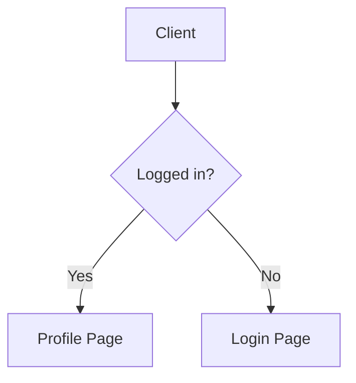

# Markdown Tutorial: From Basics to GitHub Open Source Contributions

Welcome to the world of Markdown! Whether you're new to programming or getting ready to contribute to open source projects on GitHub, Markdown lets you format plain text quickly and keep your focus on the content itself.

This guide starts with the basics and moves on to the formats commonly used in GitHub documentation. Every example is rendered live on this site. Read it in order or jump straight to a section:

- [Basic Markdown Syntax](#basic-markdown-syntax-most-commonly-used): headings, paragraphs, lists, links, images, blockquotes, and code
- [GitHub Documentation and Collaboration Formats](#github-documentation-and-collaboration-formats): task lists, tables, footnotes, automatic links, mentions, badges, and details
- [Advanced Techniques](#advanced-techniques-less-common-extended-content): formulas, Mermaid, internal anchors, and callouts
- [Recommended Reading and Tools](#recommended-reading-and-tools)

## Basic Markdown Syntax (Most Commonly Used)

### 1. Headings

Markdown supports headings from level 1 to 6, indicated by `#` symbols. The number of `#` symbols represents the heading level.

```markdown
# Heading 1

## Heading 2

### Heading 3

###### Heading 6
```

💡 **Best Practice**: Always leave a space between the `#` and the heading text. This is standard Markdown syntax.

### 2. Paragraphs, Line Breaks, and Horizontal Rules

- **Paragraphs**: Simply leave a blank line to create a new paragraph.
- **Line Breaks**: Add **two or more spaces** at the end of the current line, then press Enter.
- **Horizontal Rules**: Use three or more consecutive asterisks `***` or hyphens `---`.

```markdown
This is the first line.  
This is the second line (the previous line has two spaces at the end for a hard line break).

This is another paragraph (there's a blank line above).

---
Above is a horizontal rule.
```

**Rendered Result:**

This is the first line.  
This is the second line (the previous line has two spaces at the end for a hard line break).

This is another paragraph (there's a blank line above).

---
Above is a horizontal rule.

### 3. Text Styles

You can add bold, italic, or strikethrough effects to text.

```markdown
This is **bold** text.
This is *italic* text.
This is ***bold and italic*** text.
This is ~~strikethrough~~ text.
```

**Rendered Result:**

This is **bold** text.  
This is *italic* text.  
This is ***bold and italic*** text.  
This is ~~strikethrough~~ text.

### 4. Lists

Lists come in unordered and ordered varieties, and can be nested through indentation.

```markdown
- Unordered list item 1
- Unordered list item 2
  - Nested sub-item (preceded by two to four spaces)
  - Another sub-item

1. Ordered list item 1
2. Ordered list item 2
   1. Nested ordered sub-item
```

**Rendered Result:**

- Unordered list item 1
- Unordered list item 2
  - Nested sub-item
  - Another sub-item

1. Ordered list item 1
2. Ordered list item 2
   1. Nested ordered sub-item
   2. Second nested ordered sub-item

### 5. Links

Links come in inline and reference styles. For directly displayed URLs, most parsers also support automatic linking.

```markdown
This is an inline link to [GitHub](https://github.com).
This is a reference link: see [Markdown documentation][1].
[1]: https://daringfireball.net/projects/markdown/
Direct URL: https://bing.com
```

**Rendered Result:**

This is an inline link to [GitHub](https://github.com).  
This is a reference link: see [Markdown documentation][1].  
Direct URL: https://bing.com

[1]: https://daringfireball.net/projects/markdown/

### 6. Images

Image syntax is similar to links, but with an exclamation mark `!` at the beginning. You can also add a `title`, which this site displays as a caption below the image.

```markdown

```

**Rendered Result:**


### 7. Blockquotes

When you need to quote someone or emphasize content, use `>`. Blockquotes can be nested and can contain other Markdown elements (like lists or code).

```markdown
> This is a blockquote.
>
> > This is nested blockquote content.
>
> - You can also use lists in blockquotes.
```

**Rendered Result:**

> This is a blockquote.
>
> > This is nested blockquote content.
>
> - You can also use lists in blockquotes.

### 8. Inline Code and Code Blocks

Code is the core of developer documentation. Inline code is wrapped with single backticks; multi-line code blocks use triple backticks.

````markdown
Type `npm install` in the terminal to install dependencies.

Here's a JavaScript code snippet:
```javascript
function greet(name) {
  console.log("Hello, " + name);
}
```
````

**Rendered Result:**

Type `npm install` in the terminal to install dependencies.

Here's a JavaScript code snippet:

```javascript
function greet(name) {
  console.log("Hello, " + name);
}
```

You can also label a fence with a file path; highlighting uses the last extension:

```src/main.js
function greet(name) {
  console.log("Hello, " + name);
}
```

💡 **Best Practice**: Specify the language identifier after the opening backticks (e.g., `javascript`, `js`, `src/main.js`, `python`, `bash`). It enables syntax highlighting and helps readers identify the code type.

## GitHub Documentation and Collaboration Formats

GitHub Flavored Markdown (GFM) extends the basics with task lists, tables, footnotes, and more. This section also covers mentions, badges, and details that are common in GitHub documentation. Mentions, badges, and details depend on the platform or this site's renderer rather than being part of every Markdown implementation.

### 1. Task Lists

Commonly used in Issues or Pull Requests for tracking to-do items in open source projects. Checkboxes visually display progress.

```markdown
- [x] Improve documentation structure
- [x] Fix homepage bug
- [ ] Write test cases
```

**Rendered Result:**

- [x] Improve documentation structure
- [x] Fix homepage bug
- [ ] Write test cases

### 2. Tables

Used for organized display of parameter descriptions or data comparisons. Use `:` to control alignment.

```markdown
| Left-aligned | Center-aligned | Right-aligned |
| :--- | :---: | ---: |
| Parameter A | `string` | Required |
| Parameter B | `number` | Optional |
```

**Rendered Result:**

| **Left-aligned** | **Center-aligned** | **Right-aligned** |
| ---------------- | ------------------ | ----------------- |
| Parameter A      | `string`           | Required          |
| Parameter B      | `number`           | Optional          |

💡 **Best Practice**: The number of alignment hyphens `-` is unlimited, but at least one is needed. Keep the code-level alignment to improve source readability.

### 3. Footnotes

Used for supplementary explanations without interrupting the main content flow. Widely supported in GitHub's Markdown.

```markdown
This is a technical term that needs explanation[^1].

[^1]: Here is the detailed explanation and supplementary information for this term.
```

**Rendered Result:**

This is a technical term that needs explanation[^1].

[^1]: Here is the detailed explanation and supplementary information for this term.

### 4. Automatic Links

GitHub automatically recognizes plain text URLs and email addresses as links. Emoji shortcodes such as `:smile:` depend on the platform; this site leaves them as plain text.

```markdown
Visit my blog: https://example.com
Contact: hello@example.com
```

**Rendered Result:** Visit my blog: [https://example.com](https://example.com), or contact [hello@example.com](mailto:hello@example.com).

### 5. Mentions and References

GitHub recognizes bare `@username`, `#123`, and commit hashes. To avoid conflicts with ordinary `@` symbols and email addresses, this site uses explicit `{@username}` syntax.

- `{@username}`: Create a GitHub mention; `{@username|Display Name}` customizes the label.
- `#123`: Link to Issue or PR #123 in the current repository.
- `d0f6f23`: A 7–40 character commit hash links to the corresponding commit.

**Rendered Result:** Thanks to {@duan-deqing}; see #123 and commit d0f6f23.

### 6. Badges

In `README.md`, projects often use badges to display build status, license, etc. Usually used in combination with `shields.io`.

```markdown

```

**Rendered Result:**


**Note**: Badges are images generated online, with text and colors controlled by parameters. This site renders them inline at a 20px height instead of stretching them across the content.

### 7. Details (Collapsible Blocks)

READMEs for open source projects can sometimes be very long. Using collapsible blocks can hide large sections of logs, configuration code, or Q&A. Markdown still works inside details; leave blank lines between `<details>`, the Markdown content, and `</details>` so the HTML and Markdown parse correctly.

````markdown
<details>
  <summary>Click to view detailed configuration code</summary>
  
  ```json
  {
    "version": "1.0.0",
    "description": "Awesome project"
  }
  ```
</details>
````

**Rendered Result:**

<details>
<summary>Click to view detailed configuration code</summary>

```json
{
  "version": "1.0.0",
  "description": "Awesome project"
}
```

</details>

### 8. Advice on HTML

GitHub and this site allow a subset of safe HTML tags, such as `<kbd>` for keyboard shortcuts, `<br>` for forced line breaks, `<details>` for collapsible blocks, and `<a name>` for custom anchors.

This site runs the content through a safe allowlist: scripts, inline styles, `iframe`, and event attributes are removed. When Markdown can express the same thing, prefer Markdown for better portability across platforms.

## Advanced Techniques (Less Common Extended Content)

### 1. Mathematical Formulas

Use `LaTeX` syntax to write mathematical formulas. GitHub now natively supports this. Use `$formula$` for inline and `$$formula$$` for block-level.

```markdown
The famous mass-energy equation is $E = mc^2$.

$$
\int_0^\infty e^{-x^2} dx = \frac{\sqrt{\pi}}{2}
$$
```

**Rendered Result:**

The famous mass-energy equation is $E = mc^2$.

$$
\int_0^\infty e^{-x^2} dx = \frac{\sqrt{\pi}}{2}
$$

### 2. Diagrams (Mermaid)

Draw diagrams using code. GitHub natively supports Mermaid syntax. Commonly used for flowcharts or architecture diagrams.

````markdown

````

This site loads Mermaid on demand and adapts diagrams to the light and dark themes.

**Rendered Result:**


### 3. Internal Anchors and Navigation

Used for navigation within long documents. GitHub generates anchors for headings automatically; this site uses the same idea—lowercase the heading, replace spaces with `-`, and remove punctuation. After the article loads, the site scrolls to the `#hash` in the URL, and automatically opens any collapsed details containing the target.

```markdown
Click here to jump to [Basic Markdown Syntax](#basic-markdown-syntax-most-commonly-used).
Or use HTML to set a custom anchor <a name="my-anchor"></a>, then jump with [Custom anchor](#my-anchor).
```

**Rendered Result:** [Jump to Basic Markdown Syntax](#basic-markdown-syntax-most-commonly-used), or [jump to Headings](#1-headings).

<a name="my-anchor"></a>
**Custom anchor target**: clicking [jump to custom anchor](#my-anchor) scrolls here.

### 4. Admonitions

Callouts highlight important information. Supported types are `NOTE`, `TIP`, `IMPORTANT`, `WARNING`, and `CAUTION`. The marker must follow `>` directly, and each type needs its own blockquote.

```markdown
> [!NOTE]
> This is a note providing useful background information.

> [!WARNING]
> This is a warning alerting you to potential risks.
```

**Rendered Result:**

> [!NOTE]
> This is a note providing useful background information.

> [!WARNING]
> This is a warning alerting you to potential risks.

### 5. Other Specific Parser Extensions

The following syntax works in some editors but is not part of GFM, and this site does not convert it:

- **Definition Lists**: `Term \n : Definition`.
- **Superscript and Subscript**: `^superscript^` and `~subscript~`; use HTML `<sup>` / `<sub>` when compatibility matters.
- **Highlight Marking**: `==highlighted content==` (requires plugins such as Typora or Markdown Preview Enhanced).

## Recommended Reading and Tools

Now that you know the core syntax, the fastest way to improve is to write more and read well-structured READMEs. These resources are a good starting point:

- **Official and Authoritative Specifications**:
  - [GitHub Flavored Markdown (GFM) Official Documentation](https://github.github.com/gfm/) - The authoritative reference for writing open source documentation.
  - [Markdown Original Syntax Documentation (John Gruber)](https://daringfireball.net/projects/markdown/) - The original specification from Markdown's creator.
- **Recommended Editors**:
  - [VS Code](https://code.visualstudio.com/) - Extremely powerful with plugins, the top choice for developers.
  - [Typora](https://typora.io/) - The ultimate "What You See Is What You Get" Markdown writing experience.
  - [Obsidian](https://obsidian.md/) - A networked knowledge management tool based on Markdown.
- **Online Practice and Tools**:
  - [Dillinger](https://dillinger.io/) - Online Markdown editing and real-time previewer.
  - [Shields.io](https://shields.io/) - Create custom badges for your open source projects.

Now, open your editor, create a `README.md`, and start your creative and open source journey!

---

**Author**: STYLAN · Email: [2030851914@qq.com](mailto:2030851914@qq.com) · GitHub: {@duan-deqing}
