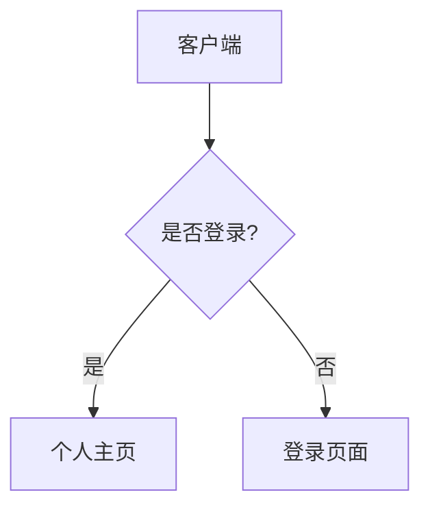

# Markdown 指南：从基础到 GitHub 开源贡献

欢迎来到 Markdown 的世界！无论你是刚接触编程的开发者，还是准备参与 GitHub 开源项目的贡献者，Markdown 都能让你用纯文本快速排版，把精力留给内容本身。

本文从基础语法讲到 GitHub 文档中常用的协作格式，所有示例都在本站真实渲染。可以按顺序阅读，也可以直接跳到需要的部分：

- [Markdown 基础语法](#markdown-基础语法最常用)：标题、段落、列表、链接、图片、引用与代码
- [GitHub 文档与协作常用格式](#github-文档与协作常用格式)：任务列表、表格、脚注、自动链接、提及、徽章与折叠块
- [进阶技巧](#进阶技巧不常用的扩展内容)：公式、Mermaid、内部锚点与提示块
- [推荐阅读与工具](#推荐阅读与工具)

## Markdown 基础语法（最常用）

### 1. 标题

Markdown 支持 1 到 6 级标题，使用 `#` 号表示，`#` 的数量代表标题的层级。

```markdown
# 一级标题

## 二级标题

###### 六级标题
```

💡 **最佳实践**：在 `#` 和标题文字之间一定要保留一个空格，这是标准的 Markdown 语法。

### 2. 段落、换行与分割线

- **段落**：只需留下一个空行，就会生成一个新的段落。
- **换行**：在当前行的结尾输入**两个或以上的空格**，然后回车。
- **分割线**：使用三个以上的连续星号 `***` 或减号 `---`。

```markdown
这是第一行。  
这是第二行（上一行末尾有两个空格，实现了硬换行）。

这是另一个段落（上面有一个空行）。

---
上面是一条分割线。
```

**渲染结果：**

这是第一行。  
这是第二行（上一行末尾有两个空格，实现了硬换行）。

这是另一个段落（上面有一个空行）。

---
上面是一条分割线。

### 3. 字体样式

你可以为文本添加加粗、斜体或删除线效果。

```markdown
这是 **加粗** 的文字。  
这是 *斜体* 的文字。
这是 ***加粗且斜体*** 的文字。
这是 ~~被删除~~ 的文字。
```

**渲染结果：**

这是 **加粗** 的文字。  
这是 *斜体* 的文字。  
这是 ***加粗且斜体*** 的文字。  
这是 ~~被删除~~ 的文字。

### 4. 列表

列表分为无序列表和有序列表，并且可以通过缩进实现嵌套。

```markdown
- 无序列表项 1
- 无序列表项 2
  - 嵌套的子项目 (前面有两到四个空格)
  - 另一个子项目

1. 有序列表项 1
2. 有序列表项 2
   1. 嵌套的有序子项目
```

**渲染结果：**

- 无序列表项 1
- 无序列表项 2
  - 嵌套的子项目（前面有两到四个空格）
  - 另一个子项目

1. 有序列表项 1
2. 有序列表项 2
   1. 嵌套的有序子项目
   2. 第二个嵌套子项目

### 5. 链接

链接分为行内式和引用式。对于直接展示的 URL，大多数解析器也支持自动链接。

```markdown
这是一个 [GitHub](https://github.com) 的行内链接。
这是一个引用链接：请参考 [Markdown 官网][1]。
[1]: https://daringfireball.net/projects/markdown/
直接使用 URL：[https://bing.com](https://bing.com)
```

**渲染结果：**

这是一个 [GitHub](https://github.com) 的行内链接。  
这是一个引用链接：请参考 [Markdown 官网][1]。  
直接使用 URL：[https://bing.com](https://bing.com)

[1]: https://daringfireball.net/projects/markdown/

### 6. 图片

图片的语法与链接类似，只是在最前面多了一个感叹号 `!`。你还可以为图片添加一个 `title`，在本站会显示为图片下方的说明文字。

```markdown

```

**渲染结果：**


本站还额外支持视频与图集扩展块：

```video
url: https://www.bilibili.com/video/BV1GJ411x7h7
title: Never Gonna Give You Up - Rick Astley
```
 
```carousel


```

### 7. 引用

当你需要引用他人的话或者强调一段内容时，可以使用 `>`。引用可以嵌套，也可以包含其他 Markdown 元素（如列表或代码）。

```markdown
> 这是一段引用。
>
> > 这是嵌套的引用内容。
>
> - 引用中也可以使用列表。
```

**渲染结果：**

> 这是一段引用。
>
> > 这是嵌套的引用内容。
>
> - 引用中也可以使用列表。

### 8. 行内代码与代码块

代码是开发者文档的核心。行内代码使用单反引号包裹；多行代码块使用三个反引号包裹。

````markdown
在终端中输入 `npm install` 来安装依赖。

下面是一段 JavaScript 代码：
```javascript
function greet(name) {
  console.log("Hello, " + name);
}
```
````

**渲染结果：**

在终端中输入 `npm install` 来安装依赖。

下面是一段 JavaScript 代码：

```JavaScript
function greet(name) {
  console.log("Hello, " + name);
}
```

也可以用文件路径标注语言，渲染时会按最后一个扩展名高亮：

```src/main.js
function greet(name) {
  console.log("Hello, " + name);
}
```

💡 **最佳实践**：在代码块开头的反引号后指定语言标识符（如 `javascript`、`js`、`src/main.js`、`python`、`bash`），既能触发语法高亮，也方便读者识别代码类型。

## GitHub 文档与协作常用格式

GitHub Flavored Markdown（GFM）在基础语法上扩展了任务列表、表格、脚注等能力；下面还会介绍 GitHub 文档里常见的提及、徽章与折叠块。其中提及、徽章和折叠块依赖平台或本站渲染器，不属于所有 Markdown 实现都支持的标准语法。

### 1. 任务列表

在 Issue 或 Pull Request 中，任务列表能直观展示待办进度。

```markdown
- [x] 完善文档结构
- [x] 修复首页 Bug
- [ ] 编写测试用例
```

**渲染结果：**

- [x] 完善文档结构
- [x] 修复首页 Bug
- [ ] 编写测试用例

### 2. 表格

用于有条理地展示参数说明或数据对比。使用 `:` 可以控制对齐方式。

```markdown
| 左对齐 | 居中对齐 | 右对齐 |
| :----- | :------: | -----: |
| 参数 A | `string` |   必填 |
| 参数 B | `number` |   选填 |
```

**渲染结果：**

| **左对齐** | **居中对齐** | **右对齐** |
| ---------- | ------------ | ---------- |
| 参数 A     | `string`     | 必填       |
| 参数 B     | `number`     | 选填       |

💡 **最佳实践**：对齐符 `-` 的数量不限，但至少需要一个。建议保持代码层面的对齐以提高源码可读性。

### 3. 脚注

用于补充说明，而不会打断主干内容的阅读。在 GitHub 的 Markdown 中已被广泛支持。

```markdown
这是一个需要解释的专业术语[^1]。

[^1]: 这里是对该术语的详细解释和补充说明。
```

**渲染结果：**

这是一个需要解释的专业术语[^1]。

[^1]: 这里是对该术语的详细解释和补充说明。

### 4. 自动链接

GitHub 会自动将纯文本网址和邮箱识别为链接。Emoji 短代码（如 `:smile:`）是否转换取决于平台，本站会保留原样。

```markdown
访问我的博客：https://example.com
联系邮箱：hello@example.com
```

**渲染结果：** 访问我的博客：[https://example.com](https://example.com)，联系邮箱：[hello@example.com](mailto:hello@example.com)。

### 5. 提及与引用

GitHub 会识别裸 `@username`、`#123` 和 commit hash。为了不与普通 `@` 符号、邮箱地址冲突，本站改用显式 `{@username}` 语法。

- `{@username}`：生成 GitHub 提及；`{@username|显示名称}` 可自定义显示文字。
- `#123`：链接到当前仓库的第 123 号 Issue 或 PR。
- `d0f6f23`：7–40 位 commit hash 会链接到对应提交。

**渲染效果：** 感谢 {@duan-deqing} 的贡献；相关讨论见 #123，对应提交 d0f6f23。

### 6. 徽章（Badge）

在 `README.md` 中，项目通常会使用徽章展示构建状态、License 等。通常结合 `shields.io` 使用。

```markdown

```

**渲染结果：**


**说明**：徽章本质上是一张在线生成的图片，通过参数改变文字和颜色。本站会把徽章按 20px 高度内联显示，而不是铺满正文。

### 7. 折叠块（Details）

开源项目的 README 有时会非常长，使用折叠块可以隐藏大段日志、配置代码或 Q&A。折叠块内部可以继续使用 Markdown；为了让 HTML 与 Markdown 正确衔接，`<details>`、Markdown 内容与 `</details>` 之间建议保留空行。

````markdown
<details>
  <summary>点击查看详细配置代码</summary>
  
  ```json
  {
    "version": "1.0.0",
    "description": "Awesome project"
  }
  ```
</details>
````

**渲染结果：**

<details>
<summary>点击查看详细配置代码</summary>

```json
{
  "version": "1.0.0",
  "description": "Awesome project"
}
```

</details>

### 8. 关于 HTML 的建议

GitHub 和本站都允许使用一部分安全的 HTML 标签，例如 `<kbd>` 键位说明、`<br>` 强制换行、`<details>` 折叠块与 `<a name>` 自定义锚点。

本站会经过安全白名单过滤：脚本、内联样式、`iframe` 和事件属性都会被移除。能用 Markdown 表达的内容仍建议优先使用 Markdown，以保证文档在不同平台间的可移植性。

## 进阶技巧（不常用的扩展内容）

### 1. 数学公式

使用 `LaTeX` 语法编写数学公式。GitHub 目前已经原生支持。行内使用 `$公式$`，块级使用 `$$公式$$`。

```markdown
著名的质能方程是 $E = mc^2$。

$$
\int_0^\infty e^{-x^2} dx = \frac{\sqrt{\pi}}{2}
$$
```

**渲染结果：**

著名的质能方程是 $E = mc^2$。

$$
\int_0^\infty e^{-x^2} dx = \frac{\sqrt{\pi}}{2}
$$

### 2. 图表（Mermaid）

使用代码的方式绘制图表，GitHub 已经原生支持 Mermaid 语法。常用于流程图或架构图。

````markdown

````

本站会按需加载 Mermaid，并让图表颜色跟随明暗主题。

**渲染结果：**


### 3. 内部锚点与跳转

用于长文档内部跳转。GitHub 会为标题自动生成锚点；本站的规则是转为小写、空格替换为 `-` 并移除标点。文章加载完成后会自动定位 URL 中的 `#hash`，若目标位于折叠块内还会自动展开。

```markdown
点击这里跳转到 [Markdown 基础语法](#markdown-基础语法最常用)。
或者使用 HTML 设置自定义锚点 <a name="my-anchor"></a>，再通过 [自定义锚点](#my-anchor) 跳转。
```

**渲染结果：** [跳到 Markdown 基础语法](#markdown-基础语法最常用)，也可以跳到 [数学公式](#1-数学公式)。

<a name="my-anchor"></a>
**自定义锚点目标**：点击 [跳到自定义锚点](#my-anchor) 会滚动到这里。

### 4. 警告块（Admonitions）

用于强调关键信息的特殊区块，支持 `NOTE`、`TIP`、`IMPORTANT`、`WARNING`、`CAUTION` 五种类型。标记必须紧跟在 `>` 后，并且每种类型独占一个引用块。

```markdown
> [!NOTE]
> 这是一个提示信息，告诉你一些有用的背景知识。

> [!WARNING]
> 这是一个警告信息，提醒你需要注意的潜在风险。
```

**渲染结果：**

> [!NOTE]
> 这是一个提示信息，告诉你一些有用的背景知识。

> [!WARNING]
> 这是一个警告信息，提醒你需要注意的潜在风险。

### 5. 其他特定解析器扩展

以下写法在部分编辑器中可用，但不属于 GFM，本站也不会转换：

- **定义列表**：`术语 \n : 释义`。
- **上下标**：`^上标^` 和 `~下标~`；需要兼容时可写 HTML 的 `<sup>` / `<sub>`。
- **高亮标记**：`==高亮内容==`（需 Typora、Markdown Preview Enhanced 等插件支持）。

## 推荐阅读与工具

掌握基础语法后，多写、多看优秀项目的 README 是提升排版能力最快的方式。以下资源可以作为参考：

- **官方与权威规范**：
  - [GitHub Flavored Markdown (GFM) 官方文档](https://github.github.com/gfm/) - 编写开源项目文档的权威参考。
  - [Markdown 原始语法文档 (John Gruber)](https://daringfireball.net/projects/markdown/) - Markdown 创始人的原始规范。
- **推荐编辑器**：
  - [VS Code](https://code.visualstudio.com/) - 搭配插件极其强大，开发者首选。
  - [Typora](https://typora.io/) - 极致的“所见即所得” Markdown 写作体验。
  - [Obsidian](https://obsidian.md/) - 基于 Markdown 的网状知识管理工具。
- **在线练习与工具**：
  - [Dillinger](https://dillinger.io/) - 在线的 Markdown 编辑和实时预览器。
  - [Shields.io](https://shields.io/) - 为你的开源项目制作专属 Badge 徽章。

现在，打开你的编辑器，创建一个 `README.md`，开始你的创作与开源之旅吧！

---

**作者**：STYLAN · 邮箱：[2030851914@qq.com](mailto:2030851914@qq.com) · GitHub：{@duan-deqing}