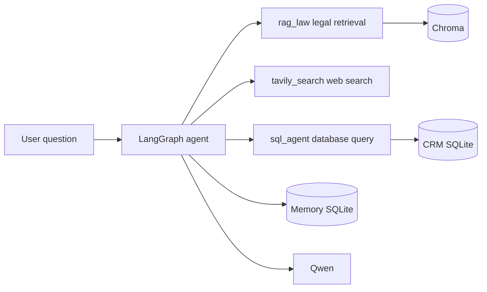

# AI CRM

An AI assistant built on LangGraph and LangChain: it retrieves legal statutes with RAG, pulls live information through Tavily, queries SQL databases in natural language, and persists conversation state in SQLite.

## Overview

AI CRM is a command-line agent. It wraps legal consultation, web search, and database queries into three tools, with LangGraph handling multi-turn decisions and tool calls. Conversation memory is stored in SQLite, so a new run can pick up where the last one left off.

## Core capabilities

- **Legal statute lookup**: RAG over the Civil Code of the People's Republic of China and related statutes, with the relevant clauses cited in answers.
- **Web search**: Tavily API for current news and real-time information the model cannot know on its own.
- **Database queries**: natural language translated into SQL against the CRM database.
- **Conversation memory**: SQLite-backed state persistence keeps multi-turn context intact.

## Architecture



## Available tools

| Tool | Purpose |
| --- | --- |
| `rag_law` | Retrieve Chinese statutes in force |
| `tavily_search` | Search the web for current information |
| `sql_agent` | Query the database in natural language |

## Quick start

### Install dependencies

```bash
pip install -r requirements.txt
pip install dashscope
```

### Configure environment variables

Fill in `utils/.env`:

```env
QWEN_API_KEY=your_qwen_api_key
TAVILY_API_KEY=your_tavily_api_key
LANGGRAPH_ALLOWED_MSGPACK_MODULES=utils.models
```

### Run

```bash
python agent.py
```

Ask questions directly, such as “What is the Civil Code's definition of domestic violence?” or “How many users are in the database?” The agent picks the matching tool on its own.

## Tech stack

| Layer | Choice |
| --- | --- |
| Agent orchestration | LangGraph |
| LLM framework | LangChain |
| Model | Qwen |
| Vector store | Chroma |
| Memory | SQLite |
| Web search | Tavily API |

## Repository

Source and configuration notes: [github.com/duan-deqing/AI_CRM](https://github.com/duan-deqing/AI_CRM)
