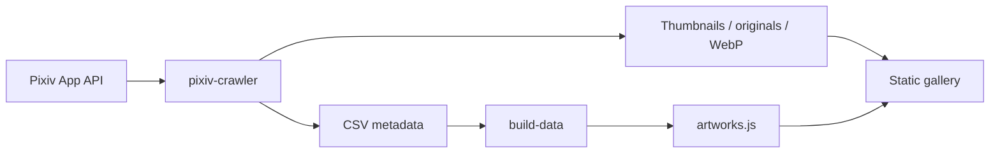

# ArtVault

[](https://www.python.org/) [](https://github.com/duan-deqing/ArtVault/blob/master/LICENSE) [](https://stylan-artvault.vercel.app)

A Pixiv illustration crawler, filter, and gallery platform. The backend is a Python CLI; the frontend is a framework-free dark glassmorphism gallery.

Live demo: [stylan-artvault.vercel.app](https://stylan-artvault.vercel.app)

## Overview

ArtVault turns keyword search, quality filtering, batch download, and gallery browsing into one local pipeline: collect artwork metadata through the Pixiv App API, filter by bookmarks and views, export CSV, then build the static gallery from that data. Images and tokens never leave your machine.

## Core capabilities

### CLI tool

- **Keyword / tag / author scanning**: multi-keyword deduplication; tags support exact, partial, and title match modes.
- **Original URL enrichment**: concurrently fetches the real `img-original` URL for each work after scanning, rate-limited.
- **Smart filtering**: by bookmarks, views, and content rating (R-15 / R-18).
- **Original downloads**: full-resolution images with automatic fallback and Referer injection to bypass hotlink protection.
- **CSV export**: 14 metadata columns including original image links.
- **Thumbnails and WebP**: batch-download thumbnails and convert originals to WebP while keeping raw files in `web/data/raw/`.
- **Removal flow**: queue works in the gallery, export the list, then run `apply_deletes.py` locally.

### Frontend gallery

- Dark glassmorphism UI with Inter + Noto Sans SC.
- Infinite scroll with a four-image concurrency limit.
- Tag pills with automatic collapse beyond five tags.
- Detail modal with full metadata, stats, tags, source links, and multi-page original switching.
- Keyboard navigation: `Esc` to close, `Enter / Space` to open, `← / →` to switch pages.

## Architecture



## Quick start

```bash
git clone https://github.com/duan-deqing/ArtVault.git
cd ArtVault

pip install -e .
cp .env.example .env      # add PIXIV_REFRESH_TOKEN; proxy optional
pixiv-crawler scan -k "Genshin Impact" --min-bookmarks 5000

pixiv-crawler build-data
python scripts/download_thumbs.py
python scripts/download_originals.py
python scripts/convert_webp.py
python scripts/build_image_index.py

cd web && python -m http.server 8000
```

Or run the whole flow in one command:

```bash
python scripts/pipeline.py "Genshin Impact"
```

Getting a refresh token:

```bash
pip install get-pixivpy-token
get-pixivpy-token
```

## Common commands

| Command | Purpose |
| --- | --- |
| `pixiv-crawler scan` | Keyword search → CSV |
| `pixiv-crawler scan-tags` | Tag search → CSV with original URL enrichment |
| `pixiv-crawler scan-author` | Author works scan → CSV |
| `pixiv-crawler download` | Search and download originals |
| `pixiv-crawler build-data` | Merge CSVs into gallery data |
| `pixiv-crawler dl-thumbs` | Download thumbnails |

## Tech stack

| Layer | Choice |
| --- | --- |
| Collection | Python 3.8+ / pixivpy3 / click / requests |
| Data | CSV, JSON index, WebP |
| Frontend | HTML5 / CSS3 / vanilla JavaScript (no build step) |
| Deployment | Vercel static hosting |
| Testing | pytest |
| License | MIT |

## Repository

Source, full docs, and screenshots: [github.com/duan-deqing/ArtVault](https://github.com/duan-deqing/ArtVault)
