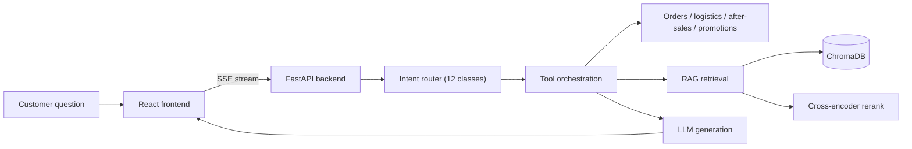

# Orbit Desk

[](https://www.python.org/) [](https://fastapi.tiangolo.com/) [](https://react.dev/) [](https://www.typescriptlang.org/) [](https://github.com/duan-deqing/e-commerce-cs-agent/blob/main/LICENSE)

A full-stack customer-support agent for e-commerce: **intent routing → tool orchestration → RAG knowledge answers → SSE streaming**, with end-to-end tracing, offline evaluation, and a bad-case loop. It runs locally out of the box.

## Overview

Orbit Desk has three parts: a FastAPI backend that orchestrates the agent and retrieves knowledge, a React + TypeScript frontend with a chat window and execution timeline, and `backend/evals/` for offline evaluation sets and reports. Without an `LLM_API_KEY`, the backend falls back to a Mock LLM so the whole pipeline can run offline.

## Core capabilities

### Agent core

- 12 intent classes with smart routing: a rule-based fast path first, LLM fallback after.
- Order / logistics / after-sales / promotion / search tools run in parallel with exponential backoff, timeout circuit breaking, and graceful degradation — at most 4 tool calls per request.
- After-sales state machine for return and refund progress, plus high-value refund risk control: amounts ≥ ¥2000 go to a human by default.

### RAG knowledge answers

- Semantic Markdown chunking (headings first, then sentence boundaries) into ChromaDB.
- Two-stage reranking: a local cross-encoder (Ollama `bge-reranker-v2-m3`) first, falling back to vector + keyword fusion scoring when unavailable.
- Pluggable vector endpoints: local Ollama `bge-large`, DashScope, or OpenAI.
- Source attribution (doc_id / title / snippet / full source file) and low-confidence refusal to curb hallucinations.

### Engineering

- SSE streaming; `reasoning` deltas from thinking models surface in the execution panel.
- Sliding context window with LLM summary compression (triggered at 14 turns), output length limits, and a cache-friendly stable prefix.
- Full-chain traces persisted: trace ID, model and prompt versions, tool and retrieval snippets, TTFT, token cost.
- `/metrics` exposes P50/P95, time to first token, error rate, handoff rate, self-service resolution rate, and bad-case rate.
- Offline evaluation: Recall@5, citation coverage, intent accuracy, and an LLM judge (accuracy / hallucination rate / faithfulness).
- Bad-case loop: categorized regression runs, prompt canary rollouts (stable crc32 bucketing), and one-click rollback.

## Architecture



> [!NOTE]
> Requests hit a rule-based fast path first. Only misses fall through to the LLM, which keeps unnecessary model calls down.

## Evaluation baseline

30 baseline cases in `backend/evals/`:

| Metric | Value |
| --- | --- |
| Recall@5 | 1.00 |
| Citation coverage | 0.68 |
| Intent accuracy | 0.93 |
| Hallucination rate | 0 |
| LLM judge faithfulness | 0.73 |

## Quick start

```bash
pnpm install
pnpm dev
```

- Backend: <http://127.0.0.1:8000> (API docs at `/docs`)
- Frontend: <http://localhost:5173>

You can also run `pnpm run api` / `pnpm run web`, or use `./scripts/run-dev.ps1`.

Reproduce the evaluation:

```bash
cd backend
python scripts/run_eval.py              # full evaluation → report.json
python scripts/run_eval.py --regress    # bad-case regression → report-regress.json
python scripts/smoke_test.py            # end-to-end smoke test (Mock LLM)
```

## Tech stack

| Layer | Choices |
| --- | --- |
| Backend | Python 3.11+ / FastAPI / SSE |
| Retrieval | ChromaDB, Ollama `bge-large`, `bge-reranker-v2-m3` |
| Frontend | React 19 / TypeScript / Vite |
| Evaluation | Recall@5, citation coverage, intent accuracy, LLM judge |
| License | MIT |

## Repository

Source, design docs, and evaluation scripts: [github.com/duan-deqing/e-commerce-cs-agent](https://github.com/duan-deqing/e-commerce-cs-agent)
