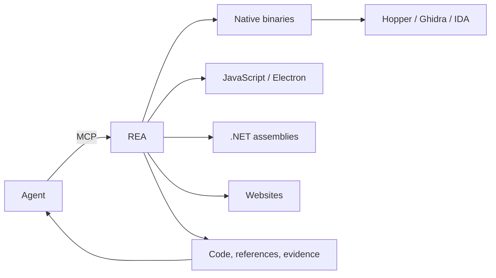

# rea

Reverse-engineering tooling for agents. When you see a feature in an app that you want in your own product, let your agent investigate it with REA — no source code required — explain how it works, show the evidence, and rebuild it for your project.

REA connects agents over MCP to tools for inspecting native binaries, JavaScript and Electron apps, .NET assemblies, and websites. The same tools are available from the terminal. Analysis runs locally, and every conclusion comes with its evidence and limitations.

> Official sources: [morluto/rea](https://github.com/morluto/rea), [rea.tools](https://rea.tools/), and the `rea-agents` npm package.

## How it works



Your agent calls REA through MCP to inspect the target and trace relevant code. REA returns findings with evidence; the agent uses them to ask follow-ups, explain behavior, or write and test an implementation.

## What you can analyze

| Target | What REA returns | Requirements |
| --- | --- | --- |
| Native binaries | Pseudocode, assembly, strings, symbols, calls, references | Hopper, Ghidra, or IDA |
| Go binaries | Compiler version, modules, replacements, build settings | Built-in static inspection; no Go install |
| Rust binaries | cargo-auditable crate names, versions, dependency edges | Built-in static inspection |
| JavaScript / Electron | Modules, imports, source maps, routes, IPC, native add-on links | Node.js and npm |
| .NET assemblies | Metadata, CIL instructions, native dependencies, build comparison | None; static only |
| Android APKs | Manifest, classes, decompiled methods, references | JADX and a JDK |
| Websites | Page structure, scripts, network observations, screenshots | A Chrome-family browser |
| Network captures | Requests, responses, exposed payloads, source locations | HAR or SAZ |
| Firmware | Regions, extraction results, native-analysis handoffs | Binwalk / Unblob |

REA also covers WASM, EVM bytecode, SQLite databases, recorded crashes, packet summaries, Flutter apps, and logic signals; see the repository docs for the full list.

## Quick start

### Set up your agent

```bash
npx rea-agents setup
```

Choose your agents, review the proposed changes, and approve them. Setup registers REA's MCP server and matching workflow instructions with backups of existing configuration. Claude Code, Codex, Cursor, Gemini CLI, Grok Build, and other agents are supported; restart your agent afterward.

### Ask your agent

```text
Understand how search works in the Notes app, show me the evidence, and build a
similar feature for my project.
```

### Use the terminal

```bash
npx -y rea-agents@latest analyze-javascript-application /absolute/path/to/app --json
```

The result includes modules, imports, Electron boundaries, and their evidence. Install the command for regular use:

```bash
npm install --global rea-agents
rea --help
```

Native analysis needs a configured Hopper, Ghidra, or IDA provider; static JavaScript and .NET analysis work without a native engine.

## Requirements

- Node.js 22.x (≥ 22.19), 24.x (≥ 24.11), or 26+, plus npm;
- Hopper / Ghidra / IDA for deep native analysis;
- A procps-compatible `ps` for some Linux capabilities.

## Tech stack

| Layer | Choice |
| --- | --- |
| Runtime | Node.js 22+ |
| Agent interface | MCP server + workflow instructions |
| CLI | `rea-agents` (global npm / bun install) |
| Native analysis | Hopper / Ghidra / IDA / JEB providers |
| Execution | Local analysis; findings include evidence and limitations |

## Links

- Repository: [github.com/duan-deqing/rea](https://github.com/duan-deqing/rea)
- Website and case studies: [rea.tools](https://rea.tools/)
