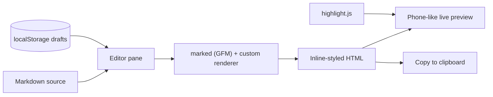

# Weijian

[](https://duan-deqing.github.io/weijian/) [](https://www.gnu.org/licenses/gpl-3.0) [](https://react.dev/) [](https://www.typescriptlang.org/) [](https://vite.dev/)

A Markdown writing workspace for WeChat official accounts: write on the left, preview the article as readers will see it on the right, then copy inline-styled HTML into the WeChat editor with one click. It runs entirely in the browser — no sign-up, no backend.

Live demo: [duan-deqing.github.io/weijian](https://duan-deqing.github.io/weijian/)

## Overview

Pasting rich text into the WeChat editor is painful: styles get stripped, and code blocks and tables rarely survive. Weijian splits the workflow into three steps: focused Markdown writing, a phone-like live preview, and inline-styled HTML ready for the WeChat editor.

## Core capabilities

| Module | What it does |
| --- | --- |
| Two-pane editor | Markdown on the left, live preview on the right; mobile switches between writing and preview |
| Layout templates | Classic official account, modern cards, literary, business-tech |
| Color schemes | Classic green, intellectual blue, cool gray, warm amber, rose, elegant purple — combined freely with layouts |
| One-click copy | Renders the preview as inline-styled HTML into the clipboard for the WeChat editor |
| Syntax highlighting | highlight.js with common languages |
| Local drafts | Up to 30 drafts in localStorage with search, rename, duplicate, delete |
| Import / export | `.md` / `.markdown` / `.txt` |
| Shortcuts | `Ctrl/Cmd + B` bold, `Ctrl/Cmd + I` italic, `Ctrl/Cmd + S` save now |

## Architecture



Preview and copy share the same HTML, so what you see is what gets pasted.

## Quick start

```bash
git clone https://github.com/duan-deqing/weijian.git
cd weijian
npm install
npm run dev
```

The default URL is `http://127.0.0.1:5173/weijian/`. Production build:

```bash
npm run build
npm run preview
```

## Usage

1. Open the homepage, click “Enter editor”, or pick a draft from “My articles”.
2. Write Markdown on the left; choose a layout and color scheme on the right — the preview updates instantly.
3. When the layout looks right, click “Copy to WeChat” and paste into the WeChat editor.
4. Upload images to the WeChat media library first, then reference their URLs in the article.

The “File” menu imports / exports Markdown; the “Sample” menu loads an example or clears the draft. Drafts live only in your browser, so export before clearing site data.

## Tech stack

| Layer | Choice |
| --- | --- |
| Frontend | React 18 + TypeScript + Vite |
| Markdown | marked (GFM) + custom renderer |
| Highlighting | highlight.js |
| Storage | localStorage |
| Deployment | GitHub Pages (hash routing) |
| License | GPL-3.0-or-later |

## Repository

Source and usage docs: [github.com/duan-deqing/weijian](https://github.com/duan-deqing/weijian)
