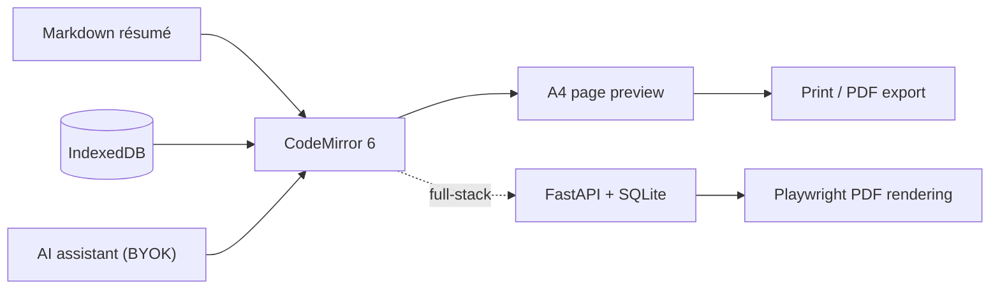

# ZensheetCV

[](https://duan-deqing.github.io/zensheetCV/) [](https://github.com/duan-deqing/zensheetCV) [](https://github.com/duan-deqing/zensheetCV/blob/master/LICENSE) [](https://react.dev/)

A Markdown-based online résumé editor: write on the left, preview page-by-page A4 output on the right, and combine eight built-in templates with fine-grained theme settings. AI helps polish the wording. It ships in two forms: a login-free web version and a full-stack version.

Live demo: [duan-deqing.github.io/zensheetCV](https://duan-deqing.github.io/zensheetCV/)

## Overview

The login-free version (`static` branch) is purely frontend: open it and start writing. Résumés and chat history stay in the browser's IndexedDB. The full-stack version (`master` branch) adds FastAPI + SQLite for multi-device sync and renders PDFs server-side with Playwright. Both share the same editing and preview experience.

## Core capabilities

### Editing and preview

- CodeMirror 6 Markdown editor with a toolbar, shortcuts, and a contextual toolbar for selections.
- Page-by-page A4 preview; block-level greedy pagination keeps entries from splitting mid-item.
- `:::left / :::mid / :::right` container syntax for three-column headers.
- `icon:name` references built-in icons, with a browsable icon library and one-click copy.

### Templates and themes

- Eight built-in templates: classic, modern blue, elegant burgundy, tech green, ink minimal, cyan-line minimal, warm orange, and carbon black.
- Fine-grained controls for accent color, body font, heading sizes, line height, page margins, and content padding.
- Most templates adapt accent colors, section bars, and list markers to the chosen accent.
- Photo upload with circular cropping, placeable in the header or body.

### AI-assisted writing (BYOK)

- Experience polishing, keyword matching, and bullet-to-paragraph rewriting with streaming SSE replies.
- “Full résumé polish” and “JD alignment” workflows run step by step with live status; JD alignment adjusts wording without inventing experience.
- Suggestions arrive as diff cards (original vs replacement) that can be applied one by one or all at once, with undo for the current round.
- An experimental agent mode can call tools across multiple turns; changes still need card-by-card confirmation.
- Connects directly from the browser to OpenAI-compatible providers; the API key stays in local storage.

## Architecture



## Quick start

### Login-free version

```bash
git clone https://github.com/duan-deqing/zensheetCV.git
cd zensheetCV
git checkout static

pnpm install
pnpm run dev            # http://localhost:5173

pnpm run test:web       # Vitest
pnpm run lint:web       # ESLint
```

No environment variables or backend are required; configure AI inside the UI. The build output goes to `apps/web/dist` and can be hosted on any static server.

### Full-stack version

```bash
git checkout master
pnpm install
cd apps/api && poetry install

pnpm run dev            # starts frontend and backend together
```

Frontend at `http://localhost:5173`, backend at `http://localhost:8000`, Swagger docs at `/docs`. The backend reads `SECRET_KEY`, `DATABASE_URL`, `OPENAI_API_KEY`, and other settings from `apps/api/.env`.

## Tech stack

| Form | Stack |
| --- | --- |
| Login-free | React 18 + TypeScript + Vite + Tailwind CSS + CodeMirror 6 |
| Data | IndexedDB (idb, in-memory fallback in private mode) |
| AI | OpenAI-compatible protocol (direct browser or server proxy) |
| Full-stack | FastAPI + SQLAlchemy (async) + SQLite + Playwright + Jinja2 |
| Deployment | GitHub Pages (login-free) / split frontend and backend (full-stack) |
| License | MIT |

## Repository

Source, bilingual README, and docs: [github.com/duan-deqing/zensheetCV](https://github.com/duan-deqing/zensheetCV)
