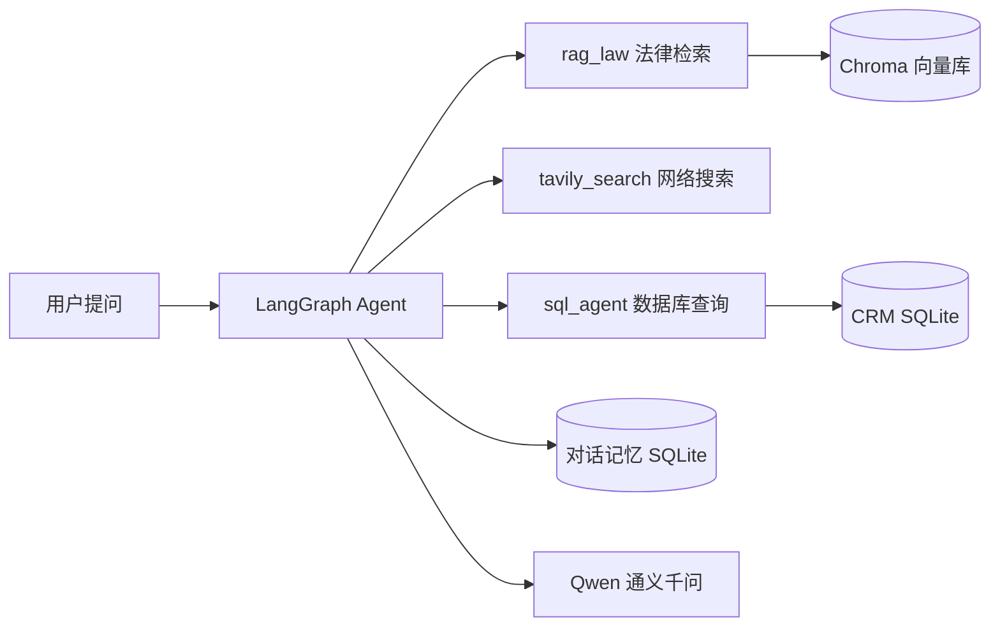

# AI CRM

基于 LangGraph 与 LangChain 构建的 AI 智能助手：用 RAG 检索法律条文、用 Tavily 获取实时资讯、用自然语言查询 SQL 数据库，并通过 SQLite 持久化对话状态。

## 概览

AI CRM 是一个命令行 Agent。它把法律咨询、联网搜索与数据库查询封装成三个工具，由 LangGraph 负责多轮决策与工具调用；对话记忆写入 SQLite，重新运行仍能接着上一轮聊。

## 核心能力

- **法律条文查询**：基于 RAG 检索《中华人民共和国民法典》等法律条文，回答附带条文依据。
- **网络搜索**：通过 Tavily API 获取最新资讯与实时信息，弥补模型知识的时效性。
- **数据库查询**：把自然语言转成 SQL，直接查询 CRM 数据库。
- **对话记忆**：基于 SQLite 的对话状态持久化，多轮上下文不丢失。

## 架构



## 可用工具

| 工具 | 功能 |
| --- | --- |
| `rag_law` | 检索中国现行法律条文 |
| `tavily_search` | 网络搜索，获取最新资讯 |
| `sql_agent` | 自然语言查询数据库 |

## 快速开始

### 安装依赖

```bash
pip install -r requirements.txt
pip install dashscope
```

### 配置环境变量

在 `utils/.env` 中填写：

```env
QWEN_API_KEY=your_qwen_api_key
TAVILY_API_KEY=your_tavily_api_key
LANGGRAPH_ALLOWED_MSGPACK_MODULES=utils.models
```

### 运行

```bash
python agent.py
```

启动后可以直接提问，例如“民法典中关于家暴的定义是什么”“查询数据库中有多少用户”，Agent 会自动选择对应工具。

## 技术栈

| 层 | 选型 |
| --- | --- |
| Agent 编排 | LangGraph |
| LLM 应用框架 | LangChain |
| 模型 | Qwen（通义千问） |
| 向量库 | Chroma |
| 记忆持久化 | SQLite |
| 网络搜索 | Tavily API |

## 仓库

源码与配置说明：[github.com/duan-deqing/AI_CRM](https://github.com/duan-deqing/AI_CRM)
