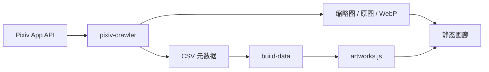

# ArtVault

[](https://www.python.org/) [](https://github.com/duan-deqing/ArtVault/blob/master/LICENSE) [](https://stylan-artvault.vercel.app)

Pixiv 插画采集、筛选与可视化平台。后端是 Python 命令行工具，前端是零框架的深色玻璃拟态画廊。

在线体验：[stylan-artvault.vercel.app](https://stylan-artvault.vercel.app)

## 概览

ArtVault 把「关键词检索 → 质量筛选 → 批量下载 → 画廊浏览」串成一条本地流水线：用 Pixiv App API 采集作品元数据，按收藏与浏览量过滤，导出 CSV，再把数据构建成静态画廊。图片与令牌都只留在本机。

## 核心能力

### 命令行工具

- **关键词 / 标签 / 作者扫描**：支持多关键词去重，标签支持精确、部分与标题三种匹配模式。
- **原图地址补全**：扫描后并发、限速补全真实 `img-original` 地址。
- **智能筛选**：按收藏数、浏览量、内容分级（R-15 / R-18）过滤。
- **原图下载**：下载原始分辨率，失败自动回退；自动注入 Referer 绕过防盗链。
- **CSV 导出**：14 列元数据，含原图链接，便于二次分析。
- **缩略图与 WebP**：批量下载缩略图，原图转换为 WebP，保留 `web/data/raw/` 原始文件。
- **删除闭环**：画廊内勾选待删作品，导出清单后本地执行 `apply_deletes.py`。

### 前端画廊

- 深色玻璃拟态界面，Inter + Noto Sans SC 字体。
- 无限滚动分页，4 张图片并发加载。
- 标签胶囊筛选，超过 5 个标签自动折叠。
- 作品详情弹窗：完整元数据、统计、标签、来源链接与多页原图切换。
- 键盘导航：`Esc` 关闭，`Enter / Space` 打开，`← / →` 切换多页作品。

## 架构



## 快速开始

```bash
git clone https://github.com/duan-deqing/ArtVault.git
cd ArtVault

pip install -e .
cp .env.example .env      # 填入 PIXIV_REFRESH_TOKEN，可选代理
pixiv-crawler scan -k "Genshin Impact" --min-bookmarks 5000

pixiv-crawler build-data
python scripts/download_thumbs.py
python scripts/download_originals.py
python scripts/convert_webp.py
python scripts/build_image_index.py

cd web && python -m http.server 8000
```

也可以一条命令跑完整流程：

```bash
python scripts/pipeline.py "Genshin Impact"
```

获取 Refresh Token：

```bash
pip install get-pixivpy-token
get-pixivpy-token
```

## 常用命令

| 命令 | 作用 |
| --- | --- |
| `pixiv-crawler scan` | 关键词搜索 → CSV |
| `pixiv-crawler scan-tags` | 标签搜索 → CSV，并补全原图地址 |
| `pixiv-crawler scan-author` | 作者作品扫描 → CSV |
| `pixiv-crawler download` | 按条件搜索并下载原图 |
| `pixiv-crawler build-data` | 合并 CSV 生成画廊数据 |
| `pixiv-crawler dl-thumbs` | 下载缩略图 |

## 技术栈

| 层 | 选型 |
| --- | --- |
| 采集 | Python 3.8+ / pixivpy3 / click / requests |
| 数据 | CSV、JSON 索引、WebP |
| 前端 | HTML5 / CSS3 / Vanilla JavaScript（无构建工具） |
| 部署 | Vercel 静态站点 |
| 测试 | pytest |
| 许可 | MIT |

## 仓库

源码、完整文档与截图：[github.com/duan-deqing/ArtVault](https://github.com/duan-deqing/ArtVault)
