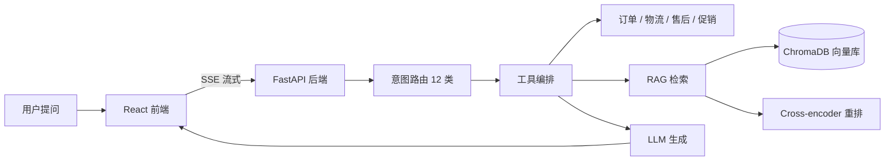

# Orbit Desk

[](https://www.python.org/) [](https://fastapi.tiangolo.com/) [](https://react.dev/) [](https://www.typescriptlang.org/) [](https://github.com/duan-deqing/e-commerce-cs-agent/blob/main/LICENSE)

面向电商业务的智能客服 Agent 全栈项目：**意图路由 → 工具编排 → RAG 知识问答 → SSE 流式生成**，配套全链路监控、离线评测与坏案例闭环，开箱即可本地演示与二次开发。

## 概览

Orbit Desk 由三部分组成：FastAPI 后端负责 Agent 编排与知识检索，React + TypeScript 前端提供对话窗口与执行时间线，`backend/evals/` 保存离线评测集与报告。未配置 `LLM_API_KEY` 时后端自动使用 Mock LLM，整条链路可以离线跑通。

## 核心能力

### Agent 核心

- 12 类意图识别与智能路由，规则快通道优先，LLM 兜底。
- 订单 / 物流 / 售后 / 促销 / 搜索工具并行编排：指数退避重试、超时熔断、失败降级，单请求不超过 4 次工具调用。
- 售后状态机（退换货进度追问）与高金额退款风控：默认 ≥ ¥2000 转人工。

### RAG 知识问答

- Markdown 语义分块（标题优先 + 句边界）写入 ChromaDB。
- 两级重排：本地 cross-encoder（Ollama `bge-reranker-v2-m3`）优先，不可用时自动降级为向量 + 关键词融合打分。
- 支持独立向量端点：本地 Ollama `bge-large`、DashScope 或 OpenAI。
- 来源溯源（doc_id / 标题 / 片段 / 来源文件全文）与低置信拒答，降低幻觉。

### 工程化

- SSE 流式输出，思考型模型的 `reasoning` 增量会透出到执行面板。
- 滑动上下文窗口 + LLM 摘要压缩（14 轮触发）、输出长度上限、cache-friendly 稳定前缀。
- 全链路 Trace 落库：Trace ID、模型与 Prompt 版本、工具与检索片段、TTFT、Token 成本。
- `/metrics` 暴露 P50/P95、首 Token 延迟、错误率、转接率、自助解决率与坏案例率。
- 离线评测：Recall@5、引用覆盖率、意图正确率、LLM judge（准确率 / 幻觉率 / 忠诚度）。
- 坏案例闭环：分类回归 + Prompt 灰度（crc32 稳定分流）+ 一键回滚。

## 架构



> [!NOTE]
> 请求先经过规则快通道，命中后直接返回；未命中才进入 LLM 兜底，减少不必要的模型调用。

## 评测基线

30 条基线测试集（`backend/evals/`）：

| 指标 | 数值 |
| --- | --- |
| Recall@5 | 1.00 |
| 引用覆盖率 | 0.68 |
| 意图正确率 | 0.93 |
| 幻觉率 | 0 |
| LLM judge 忠诚度 | 0.73 |

## 快速开始

```bash
pnpm install
pnpm dev
```

- 后端：<http://127.0.0.1:8000>（API 文档在 `/docs`）
- 前端：<http://localhost:5173>

也可以单独运行 `pnpm run api` / `pnpm run web`，或使用 `./scripts/run-dev.ps1`。

复现评测：

```bash
cd backend
python scripts/run_eval.py              # 全量评测 → report.json
python scripts/run_eval.py --regress    # 坏案例回归 → report-regress.json
python scripts/smoke_test.py            # 端到端冒烟（Mock LLM）
```

## 技术栈

| 层 | 选型 |
| --- | --- |
| 后端 | Python 3.11+ / FastAPI / SSE |
| 检索 | ChromaDB、Ollama `bge-large`、`bge-reranker-v2-m3` |
| 前端 | React 19 / TypeScript / Vite |
| 评测 | Recall@5、引用覆盖率、意图正确率、LLM judge |
| 许可 | MIT |

## 仓库

源码、设计文档与评测脚本：[github.com/duan-deqing/e-commerce-cs-agent](https://github.com/duan-deqing/e-commerce-cs-agent)
