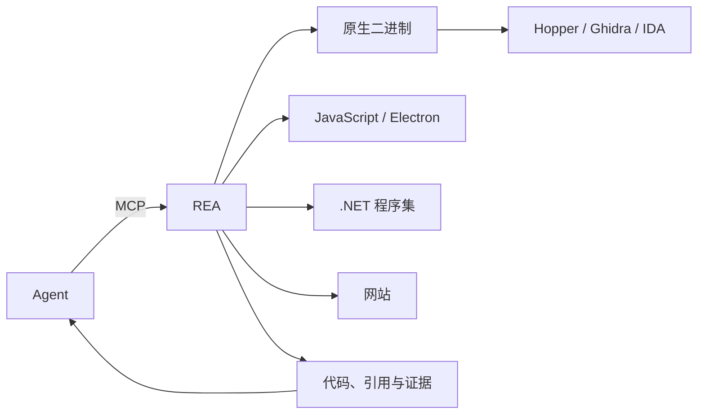

# rea

面向 Agent 的逆向工程工具。看到一个应用里的功能想搬进自己的产品时，可以让 Agent 用 REA 在没有源码的情况下检查应用、解释它如何工作、给出证据，并在你的项目里重新实现。

REA 把原生二进制、JavaScript / Electron 应用、.NET 程序集与网站的检查工具接到 Agent 的 MCP 上，同一套工具也能在终端里直接调用。分析全部在本地运行，结论会带上证据与限制。

> 官方来源为 [morluto/rea](https://github.com/morluto/rea)、[rea.tools](https://rea.tools/) 与 npm 包 `rea-agents`。

## 工作方式



Agent 通过 MCP 调用 REA 检查目标并追踪相关代码；REA 返回带证据的发现，Agent 再据此追问、解释行为或编写并测试实现。

## 可以分析什么

| 目标 | 返回内容 | 依赖 |
| --- | --- | --- |
| 原生二进制 | 伪代码、汇编、字符串、符号、调用与引用 | Hopper、Ghidra 或 IDA |
| Go 二进制 | 编译器版本、模块、替换与构建设置 | 内置静态检查，无需安装 Go |
| Rust 二进制 | cargo-auditable 的 crate 名称、版本与依赖边 | 内置静态检查 |
| JavaScript / Electron | 模块、导入、source map、路由、IPC 与原生插件关系 | Node.js 与 npm |
| .NET 程序集 | 元数据、CIL 指令、原生依赖与构建对比 | 无，纯静态分析 |
| Android APK | Manifest、类、反编译方法与引用 | JADX + JDK |
| 网站 | 页面结构、脚本、网络观察与截图 | Chrome 系浏览器 |
| 网络抓包 | 请求、响应、暴露的载荷与来源位置 | HAR 或 SAZ |
| 固件 | 分区、提取结果与原生分析交接 | Binwalk / Unblob |

此外还支持 WASM、EVM 字节码、SQLite 数据库、崩溃记录、抓包摘要、Flutter 应用与逻辑信号等目标，完整列表见仓库文档。

## 快速开始

### 接入 Agent

```bash
npx rea-agents setup
```

选择要接入的 Agent，检查将要写入的配置并确认；setup 会注册 REA 的 MCP 服务与对应工作流说明，并备份已有配置。支持 Claude Code、Codex、Cursor、Gemini CLI、Grok Build 等 Agent，完成后重启 Agent。

### 向 Agent 提问

```text
Understand how search works in the Notes app, show me the evidence, and build a
similar feature for my project.
```

### 在终端使用

```bash
npx -y rea-agents@latest analyze-javascript-application /absolute/path/to/app --json
```

返回模块、导入、Electron 边界与对应证据。需要常用命令时全局安装：

```bash
npm install --global rea-agents
rea --help
```

原生分析需要先配置 Hopper、Ghidra 或 IDA 等 provider；静态 JavaScript 与 .NET 分析不需要原生引擎。

## 环境要求

- Node.js 22.x（≥ 22.19）、24.x（≥ 24.11）或 26+，以及 npm；
- 原生分析需自备 Hopper / Ghidra / IDA；
- Linux 上的部分能力需要 procps 兼容的 `ps`。

## 技术栈

| 层 | 选型 |
| --- | --- |
| 运行时 | Node.js 22+ |
| Agent 接口 | MCP server + 工作流说明 |
| 命令行 | `rea-agents` CLI（npm / bun 全局安装） |
| 原生分析 | Hopper / Ghidra / IDA / JEB 等 provider |
| 运行方式 | 本地分析，结果附带证据与限制 |

## 链接

- 仓库：[github.com/duan-deqing/rea](https://github.com/duan-deqing/rea)
- 官网与案例：[rea.tools](https://rea.tools/)
