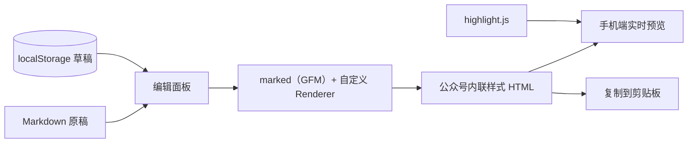

# 微笺

[](https://duan-deqing.github.io/weijian/) [](https://www.gnu.org/licenses/gpl-3.0) [](https://react.dev/) [](https://www.typescriptlang.org/) [](https://vite.dev/)

面向微信公众号的 Markdown 写作工作台 —— 左边写原稿，右边看微信图文观感，一键复制带内联样式的内容到公众号后台。纯前端运行，无需注册与后端服务。

在线体验：[duan-deqing.github.io/weijian](https://duan-deqing.github.io/weijian/)

## 概览

公众号后台对富文本粘贴不友好：样式容易被剥离，代码块与表格也不好看。微笺把写作流程拆成三步：Markdown 专注书写、接近手机端图文的实时预览、生成可粘贴到公众号的内联样式 HTML。

## 核心能力

| 模块 | 说明 |
| --- | --- |
| 双栏编辑 | 左侧 Markdown，右侧实时预览；移动端可切换「写作 / 预览」 |
| 版式模版 | 经典公众号、现代卡片风、文艺雅致风、商务科技风 |
| 配色方案 | 经典绿、知性蓝、冷灰黑、暖琥珀、蔷薇红、优雅紫，可与版式独立组合 |
| 一键复制 | 预览渲染为内联 style HTML 写入剪贴板，直接粘贴公众号后台 |
| 语法高亮 | 基于 highlight.js，覆盖常见语言 |
| 本地草稿 | localStorage 最多 30 份，支持搜索、重命名、复制、删除 |
| 导入导出 | `.md` / `.markdown` / `.txt` |
| 快捷键 | `Ctrl/Cmd + B` 加粗、`Ctrl/Cmd + I` 斜体、`Ctrl/Cmd + S` 立即保存 |

## 架构



渲染与复制共用同一份 HTML，尽量保证「预览所见 = 粘贴所得」。

## 快速开始

```bash
git clone https://github.com/duan-deqing/weijian.git
cd weijian
npm install
npm run dev
```

默认地址是 `http://127.0.0.1:5173/weijian/`。生产构建：

```bash
npm run build
npm run preview
```

## 使用说明

1. 打开首页，点击「进入编辑器」，或从「我的文章」选择草稿。
2. 左侧输入 Markdown，右侧选择版式与配色，预览即时更新。
3. 确认排版后点击「复制到公众号」，再粘贴到公众号后台。
4. 图片先上传到公众号素材库，再在文中使用图片 URL。

「文件」菜单支持导入 / 导出 Markdown，「示例」菜单可载入示例或清空当前稿。草稿只保存在本机浏览器，清理数据前请先导出。

## 技术栈

| 层 | 选型 |
| --- | --- |
| 前端 | React 18 + TypeScript + Vite |
| Markdown | marked（GFM）+ 自定义 Renderer |
| 高亮 | highlight.js |
| 存储 | localStorage |
| 部署 | GitHub Pages（Hash 路由） |
| 许可 | GPL-3.0-or-later |

## 仓库

源码与操作文档：[github.com/duan-deqing/weijian](https://github.com/duan-deqing/weijian)
