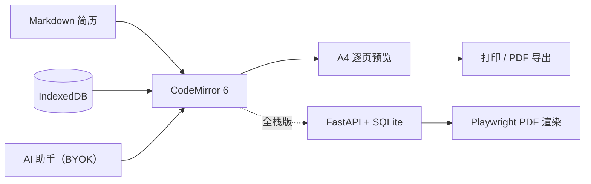

# ZensheetCV

[](https://duan-deqing.github.io/zensheetCV/) [](https://github.com/duan-deqing/zensheetCV) [](https://github.com/duan-deqing/zensheetCV/blob/master/LICENSE) [](https://react.dev/)

基于 Markdown 的在线简历编辑器：左侧书写 Markdown，右侧逐页实时预览 A4 纸面效果，8 套内置模板与细粒度主题配置自由组合，AI 辅助打磨表达。项目提供免登录在线版与全栈版两种形态。

在线体验：[duan-deqing.github.io/zensheetCV](https://duan-deqing.github.io/zensheetCV/)

## 概览

免登录在线版（`static` 分支）是纯前端实现，打开即用，简历与对话历史保存在浏览器 IndexedDB；全栈版（`master` 分支）使用 FastAPI + SQLite，支持多设备同步，并由服务端 Playwright 渲染导出 PDF。两个版本共享同一套编辑与预览能力。

## 核心能力

### 编辑与预览

- CodeMirror 6 Markdown 编辑器，工具栏、快捷键与选区上下文工具栏齐全。
- A4 纸面逐页实时预览，块级贪心分页，条目不会在中间断页。
- `:::left / :::mid / :::right` 分栏语法，实现页眉三栏排版。
- `icon:名称` 引用内置图标，提供图标库弹窗浏览与一键复制。

### 模板与主题

- 8 套内置模板：经典简洁、现代蓝调、优雅酒红、科技墨绿、墨纸极简、青线极简、朝阳暖橙、碳黑章标。
- 主色调、正文字体、分类字号、行距、页边距与内容边距均可细粒度调整。
- 多数模板的强调色、章节条与列表符号随主色调联动。
- 简历照片上传与圆形裁剪，可放在页眉或正文任意位置。

### AI 辅助写作（BYOK）

- 经历润色、关键词匹配、要点成段，SSE 流式回复。
- 「全文润色」与「JD 对齐」深度工作流，每步状态实时展示；JD 对齐只调整表述，不编造经历。
- 修改建议以 diff 确认卡片逐条呈现，支持单条 / 全部应用与一键撤销。
- Agent 模式可调用工具多轮探索，仍需逐条确认后才修改文档。
- 浏览器直连 OpenAI 兼容供应商，API Key 仅保存在本地浏览器。

## 架构



## 快速开始

### 免登录在线版

```bash
git clone https://github.com/duan-deqing/zensheetCV.git
cd zensheetCV
git checkout static

pnpm install
pnpm run dev            # http://localhost:5173

pnpm run test:web       # Vitest
pnpm run lint:web       # ESLint
```

无需环境变量与后端服务，AI 功能在界面内配置即可使用。构建产物输出到 `apps/web/dist`，可托管到任意静态服务器。

### 全栈版

```bash
git checkout master
pnpm install
cd apps/api && poetry install

pnpm run dev            # 同时启动前端与后端
```

前端 `http://localhost:5173`，后端 `http://localhost:8000`，Swagger 文档在 `/docs`。后端从 `apps/api/.env` 读取 `SECRET_KEY`、`DATABASE_URL`、`OPENAI_API_KEY` 等配置。

## 技术栈

| 形态 | 技术 |
| --- | --- |
| 免登录版 | React 18 + TypeScript + Vite + Tailwind CSS + CodeMirror 6 |
| 数据 | IndexedDB（idb，隐私模式降级内存） |
| AI | OpenAI 兼容协议（浏览器直连 / 服务端代理） |
| 全栈版 | FastAPI + SQLAlchemy (async) + SQLite + Playwright + Jinja2 |
| 部署 | GitHub Pages（免登录版）/ 前后端分离（全栈版） |
| 许可 | MIT |

## 仓库

源码、双语 README 与文档：[github.com/duan-deqing/zensheetCV](https://github.com/duan-deqing/zensheetCV)
