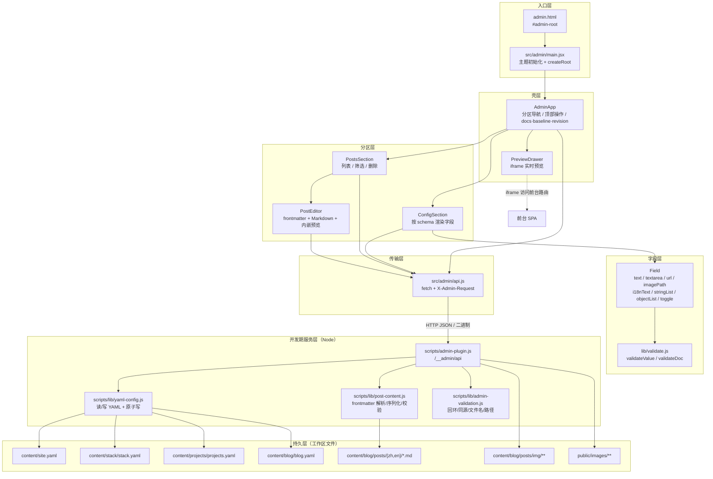
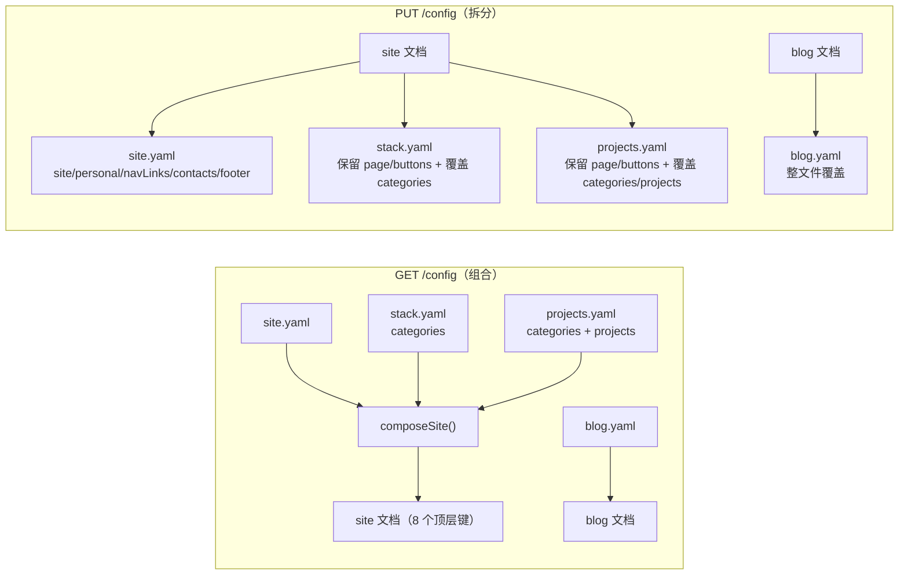
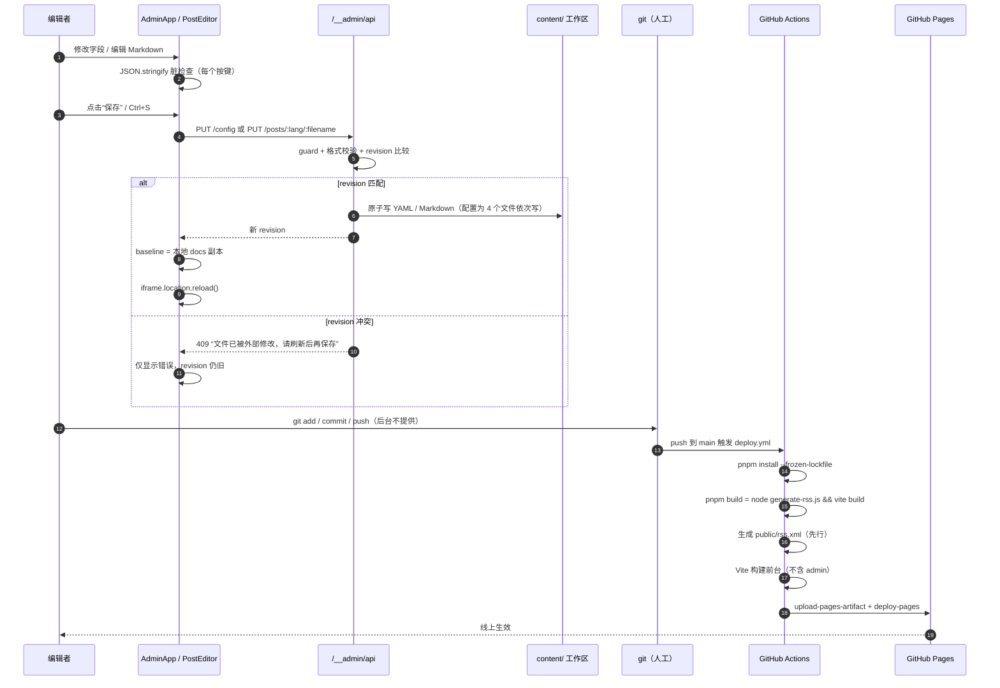

# 本地内容后台（Admin）架构评审

> 分析对象：`d:\@duan-deqing\ProjectFiles\STYLAN_Project\duan-deqing-site`
> 分析方式：只读静态阅读（未运行 `build` / `test` / `dev`，未修改任何既有代码、配置或内容文件）
> 结论日期：2026-11-03
> 说明：文中 `path:line-line` 为证据位置，链接使用仓库相对路径；行号以本次分析时的文件内容为准。

---

## 0. 结论先行

1. **后台不是一个“应用内路由”，而是一个只在 `vite dev` 下存在的独立本地页面。**
   `admin.html` 是第二个 HTML 入口，`src/admin/main.jsx` 直接挂载 `AdminApp`，没有使用 React Router；`scripts/admin-plugin.js` 以 `apply: 'serve'` 注册 `/__admin/api` 中间件，并把 `/admin` 重写到 `admin.html`。`pnpm build` 的产物不包含后台（`vite.config.js:15`、`vite.config.js:26-29`、`scripts/admin-plugin.js:349-368`、`README.md:329`）。

2. **数据层是“直接读写工作区文件”的本地 HTTP API，不是数据库也不是 GitHub API。**
   配置被组合成一个虚拟文档：`site.yaml` + `stack.yaml` + `projects.yaml` 三个文件被拼成 `site`，`blog.yaml` 作为 `blog`；保存时再拆回三个文件覆盖写（`scripts/admin-plugin.js:79-101`、`155-168`）。文章就是 `content/blog/posts/{zh,en}/*.md`，frontmatter 用 `front-matter` 解析、`yaml` 序列化（`scripts/lib/post-content.js:12-27`）。

3. **状态管理是“单组件 `useState` + JSON 全量比较”，冲突控制是“mtime revision + 409”。**
   没有 Redux / TanStack Query / Context；脏检查用 `JSON.stringify(docs)`（`src/admin/AdminApp.jsx:39-42`）。配置 revision 是三个文件 mtime 的**和**（`scripts/admin-plugin.js:75-77`、`140-150`），文章 revision 是单文件 mtime（`scripts/admin-plugin.js:243-252`）。

4. **鉴权不存在“登录”这一层，只有“本机 + 同源 + 自定义请求头”三道开发期护栏。**
   没有 token、没有用户、没有权限、没有审计；前端也不存任何凭据（`localStorage` 只存主题，`sessionStorage` 只存当前分区）。因此**不存在 token 泄漏面**，但也意味着没有身份与追责能力（`scripts/admin-plugin.js:63-73`、`scripts/lib/admin-validation.js:3-16`、`src/admin/main.jsx:10-18`、`src/admin/AdminApp.jsx:17-19`）。

5. **“保存”不等于“发布”。**
   后台只改工作区文件；上线依赖人工 `git commit/push` 到 `main`，再由 GitHub Actions 执行 `pnpm build`（先生成 RSS，再 Vite 构建）并部署到 Pages（`package.json:8`、`.github/workflows/deploy.yml:4-6`、`41-58`、`scripts/generate-rss.js:249-250`）。后台没有任何 git / 发布动作（全局搜索 `src/admin` 无 git/commit/publish 实现）。

6. **规模判断：对“个人站点 + 单用户 + 本机维护”这个规模，整体不过度，属于“够用且轻”；不足集中在四处：**
   - 409 冲突后**没有恢复路径**（只能整页刷新，stale revision 会让后续保存持续失败）；
   - 多文件配置保存**不是事务**，且聚合 revision 粒度粗；
   - 后台覆盖的内容只占 `content/` 的一部分，却以“内容管理”全貌呈现；
   - 发布链路与 RSS 存在静默失败 / 重复 URL 等正确性问题。

> 若只做三件事，建议顺序：**① 保存可靠性（冲突恢复 + 事务 + 服务端回写）→ ② 发布链路收口（CI 校验 + RSS 正确性）→ ③ 内容模型单一事实源与覆盖边界**（详见第 5 节）。

---

## 1. 现状架构

### 1.1 入口与运行方式

| 维度 | 现状 | 证据 |
| --- | --- | --- |
| 入口文件 | `admin.html`，`<div id="admin-root">` + `/src/admin/main.jsx` | `admin.html:10-11` |
| 运行方式 | 仅 `vite dev`。插件 `apply: 'serve'`，且只在 `command === 'serve'` 时加载 | `scripts/admin-plugin.js:349-352`、`vite.config.js:15` |
| URL | `/admin`、`/admin/` 被中间件重写为 `/admin.html` | `scripts/admin-plugin.js:354-357` |
| 与前台关系 | 两个独立 HTML 文档，共享 `src/index.css`（Tailwind + 全站令牌/基础层）和部分组件 | `src/admin/main.jsx:3-7`、`src/index.css:1-4` |
| 构建产物 | 默认 Vite 单入口只构建 `index.html`，`dist/` 中没有 `admin.html`；README 也明确后台不参与构建 | `vite.config.js:26-29`、`README.md:329`、`dist/` 目录实测无 `admin.html` |
| 访问范围 | 服务端只接受回环地址；跨源请求拒绝；非 GET 需 `X-Admin-Request: 1` | `scripts/admin-plugin.js:63-73`、`scripts/lib/admin-validation.js:3-16` |

**结论**：这是“本地编辑器 / dev tool”，不是可部署的 CMS。它的安全边界完全建立在“进程只跑在自己机器上、只监听回环”这个前提上。

---

### 1.2 路由结构：没有 URL 路由，只有“分区”

后台没有路由表。左侧导航由 `contentSchema` 的 `id/label` 派生，末尾追加 `posts`（`src/admin/AdminApp.jsx:11`）。当前分区存在 `sessionStorage`，刷新可恢复（`src/admin/AdminApp.jsx:17-19`、`63-65`）；页面切换由 `goTo()` 直接改 `activeId`（`src/admin/AdminApp.jsx:127-131`）。

| 分区 id | 中文 | 虚拟文档 / 路径 | 对应磁盘文件 |
| --- | --- | --- | --- |
| `site` | 站点信息 | `site.site` | `content/site.yaml` |
| `personal` | 个人信息 | `site.personal` | `content/site.yaml` |
| `nav` | 导航 | `site.navLinks` | `content/site.yaml` |
| `skills` | 技能 | `site.skills` | `content/stack/stack.yaml` → `categories` |
| `projectCategories` | 项目分类 | `site.projectCategories` | `content/projects/projects.yaml` → `categories` |
| `projects` | 项目 | `site.projects` | `content/projects/projects.yaml` → `projects` |
| `contact` | 联系方式 | `site.contacts` | `content/site.yaml` |
| `footer` | 页脚 | `site.footer` | `content/site.yaml` |
| `blog` | 博客设置 | `blog`（整篇） | `content/blog/blog.yaml` |
| `posts` | 文章管理 | 无（独立数据流） | `content/blog/posts/{zh,en}/*.md` |

证据：`src/admin/schema.js:5-149`、`src/admin/AdminApp.jsx:44-45`、`258-267`。

> 注意：分区没有 URL，因此无法深链到某一分区，也无法在浏览器历史中前进/后退；移动端侧栏靠 `scrollIntoView` 把当前分区拉回视野（`src/admin/AdminApp.jsx:68-71`）。

---

### 1.3 组件分层与数据流



分层职责：

- **入口层**：`main.jsx` 只做主题恢复与渲染（`src/admin/main.jsx:10-24`）。
- **壳层**：`AdminApp` 负责全局文档、脏状态、保存/撤销、分区、快捷键、预览开关（`src/admin/AdminApp.jsx:14-131`）。它不直接处理字段细节。
- **分区层**：
  - `ConfigSection` 根据 schema 逐字段渲染，`onChange` 以“浅合并对象”的方式回写（`src/admin/sections/ConfigSection.jsx:3-28`）。
  - `PostsSection` 负责文章列表、语言筛选、删除、进入/退出编辑器（`src/admin/sections/PostsSection.jsx:18-66`）。
  - `PostEditor` 自带一套文章本地状态、快照脏检查、分类加载、图片上传、Markdown 预览（`src/admin/sections/PostEditor.jsx:106-355`）。
- **字段层**：`Field.jsx` 是一个极简的“schema → 控件”解释器，支持 7 类复合控件与 4 类基础输入；嵌套对象与对象列表递归渲染（`src/admin/components/Field.jsx:21-51`、`53-66`、`204-242`）。
- **传输层**：`api.js` 统一加 `X-Admin-Request`、JSON 序列化、错误归一化（`src/admin/api.js:3-19`）。
- **服务层**：单文件 `admin-plugin.js` 同时承担路由、守卫、校验、组合/拆分、文件读写、上传，属于“胖 handler”（`scripts/admin-plugin.js:307-347`）。
- **持久层**：纯文件系统；没有数据库、没有远端 API。

---

### 1.4 状态管理方式

| 状态 | 位置 | 说明 |
| --- | --- | --- |
| `docs` | `AdminApp` state | 内存中的完整可编辑文档 `{ site, blog }`（`src/admin/AdminApp.jsx:14`） |
| `baseline` | `AdminApp` state | 最近一次加载/保存后的快照，用于脏检查与撤销（`src/admin/AdminApp.jsx:16`、`95`、`108`） |
| `revision` | `AdminApp` state | 服务端返回的冲突版本号（`src/admin/AdminApp.jsx:15`、`53`、`94`） |
| `dirty` | `useMemo` | `JSON.stringify(docs) !== JSON.stringify(baseline)`（`src/admin/AdminApp.jsx:39-42`） |
| `saving / status` | 局部 state | 保存中与成功/错误提示（`src/admin/AdminApp.jsx:23-24`） |
| `postDirty` | `AdminApp` state | 由 `PostEditor` 上报，用于切换分区时确认（`src/admin/AdminApp.jsx:25`、`128`、`src/admin/sections/PostEditor.jsx:176-180`） |
| `activeId` | state + `sessionStorage` | 当前分区（`src/admin/AdminApp.jsx:17-19`） |
| `dark` | state + `localStorage('theme')` | 与前台共享同一主题键（`src/admin/AdminApp.jsx:26-37`、`src/admin/main.jsx:11-15`） |
| 文章编辑态 | `PostEditor` 局部 state | `frontmatter / body / date / slug / revision / snapshot`（`src/admin/sections/PostEditor.jsx:106-121`） |
| 预览态 | `AdminApp` state | `open / page / device`，不持久化（`src/admin/AdminApp.jsx:20-22`） |

特点与后果：

- **没有服务端状态缓存层**：每次进入文章分区都会重新 `GET /posts`（`PostsSection` 的 `useEffect`，`src/admin/sections/PostsSection.jsx:18-37`）；进入编辑器还会再 `GET /config` 取分类（`src/admin/sections/PostEditor.jsx:127-139`），与壳层已加载的 `docs.blog` 重复请求。
- **脏检查是整文档字符串比较**：字段多、正文长时会随每次按键执行一次全量 `JSON.stringify`（`src/admin/AdminApp.jsx:39-42`），见 3.3 M3。
- **保存成功后 baseline 用的是“本地副本”而不是服务端回写的值**：`setBaseline(JSON.parse(JSON.stringify(docs)))`（`src/admin/AdminApp.jsx:95`），服务端只返回 `revision`（`scripts/admin-plugin.js:169-171`）。如果服务端序列化会丢弃空值、调整键序或保留未提交字段，界面状态与磁盘可能出现细微差异，直到下一次加载才对齐。
- **撤销是整文档回滚**：`setDocs(baseline)` + iframe reload（`src/admin/AdminApp.jsx:105-111`），没有字段级撤销/重做。

---

### 1.5 鉴权 / 身份校验

后台**没有任何认证与授权实现**，只有三层“开发期护栏”：

| 护栏 | 规则 | 证据 | 覆盖范围 |
| --- | --- | --- | --- |
| 回环限制 | `remoteAddress` 必须是 `127.0.0.1` / `::1` / `::ffff:127.0.0.1` | `scripts/lib/admin-validation.js:3-7`、`scripts/admin-plugin.js:64-66` | 所有 API |
| 同源限制 | `Origin` 必须与 `Host` 相同；**`Origin` 缺失时直接放行** | `scripts/lib/admin-validation.js:9-16`、`scripts/admin-plugin.js:67-69` | 所有 API |
| 自定义头 | 非 GET 必须带 `X-Admin-Request: 1` | `scripts/admin-plugin.js:70-72`、`src/admin/api.js:5` | 写操作 |

补充事实：

- 前端不保存任何 token；`localStorage` 只有 `theme`（`src/admin/main.jsx:11-15`、`src/admin/AdminApp.jsx:35`），`sessionStorage` 只有分区 id（`src/admin/AdminApp.jsx:18`、`64`）。
- 文章与配置接口不区分用户，也没有审计日志；删除是直接 `unlink`（`scripts/admin-plugin.js:257-270`）。
- 因此“token 存放与泄漏风险”在本项目当前形态下**不存在**；真正的风险是“只要能连上这个 dev server，就能无认证改写内容”。

威胁模型（静态推演，未实测）：

| 场景 | 结果 | 说明 |
| --- | --- | --- |
| 本机其他进程/脚本直接请求 | 可读写 | 回环 + 自定义头都能伪造；本机进程本就可直接改文件，风险增量有限 |
| 恶意网页发起跨源请求 | 写操作被拦 | 带 `Origin` 且不同源会被拒；简单请求无法带自定义头，会触发预检 |
| 恶意网页发起跨源 GET | 可读取 | GET 不需要自定义头；若浏览器允许跨源读取，仍受同源策略限制（通常读不到响应体） |
| DNS rebinding | 理论可绕过同源判断 | 攻击者让 `Host` 与 `Origin` 都是自己的域名，同时解析到 `127.0.0.1`；当前校验只比较字符串相等（`scripts/lib/admin-validation.js:9-16`），未校验 Host 白名单 |
| `vite --host` / 局域网访问 | 全部 403 | `remoteAddress` 非回环；功能不可用，但也不暴露 |
| 反向代理 / 远程容器端口转发 | 可能被当成回环 | 若代理在本机发起请求，`remoteAddress` 可能是 `127.0.0.1`，护栏失效 |

> 结论：**当前鉴权是“网络位置信任”，不是身份信任**。对 dev-only 本地工具是合理取舍；一旦把 dev server 暴露给他人（远程开发、容器转发、内网共享），就必须补身份层。

---

### 1.6 数据来源与读写方式

#### 1.6.1 API 面

前缀固定为 `/__admin/api`（`scripts/admin-plugin.js:24`、`src/admin/api.js:1`）。

| 方法 | 路径 | 作用 | 证据 |
| --- | --- | --- | --- |
| GET | `/config` | 读取组合后的 `{ site, blog, revision }` | `scripts/admin-plugin.js:313-315`、`95-101` |
| PUT | `/config` | 校验 revision 与顶层字段后，拆分写 4 个 YAML | `scripts/admin-plugin.js:316-318`、`121-172` |
| GET | `/posts` | 列出中英文全部文章元数据 | `scripts/admin-plugin.js:320-322`、`181-207` |
| GET | `/posts/:lang/:filename` | 读取单篇 frontmatter + body + mtime revision | `scripts/admin-plugin.js:324-336`、`209-228` |
| PUT | `/posts/:lang/:filename` | 校验 frontmatter 与 revision 后写文件 | `scripts/admin-plugin.js:334`、`230-255` |
| DELETE | `/posts/:lang/:filename` | 直接删除 Markdown（不删配图） | `scripts/admin-plugin.js:335`、`257-270` |
| POST | `/upload?target=site\|post&name=&post=` | 二进制上传图片，返回 URL | `scripts/admin-plugin.js:338-344`、`284-305` |
| — | 其他 | 统一 404 JSON | `scripts/admin-plugin.js:346` |

#### 1.6.2 配置的“组合 / 拆分”



证据：`scripts/admin-plugin.js:79-93`（组合）、`103-108`（允许的顶层键）、`152-168`（拆分写）。这解释了一个关键设计：**后台里的 “site” 不是单个文件，而是 3 个物理文件的逻辑视图**；`stack.yaml` / `projects.yaml` 的 `page`、`buttons` 等字段不在后台 schema 中，但保存时会通过 `...stack` / `...projects` 保留（`scripts/admin-plugin.js:152-167`）。

#### 1.6.3 写入原子性与版本

- 单文件写入是“临时文件 + rename”（`scripts/lib/fs-atomic.js:3-7`）；YAML 写入前统一加固定文件头（`scripts/lib/yaml-config.js:5-9`、`16-18`）。
- **多文件保存不是事务**：`saveConfig` 依次写 4 个文件，任一失败都会留下“部分已写”的状态（`scripts/admin-plugin.js:155-168`）。
- 配置 revision：`siteRevision()` 把 3 个文件的 mtime 相加（`scripts/admin-plugin.js:75-77`），比较时 `Math.round`（`140-150`）。这是**粗粒度聚合**：无法区分“哪个文件变了”，也可能出现不同组合的 mtime 之和相同（概率低但非零）。
- 文章 revision：单文件 mtime，`Math.round` 后比较（`scripts/admin-plugin.js:243-252`）。

#### 1.6.4 上传

- 目标目录：文章配图 `content/blog/posts/img/<文章目录>/`；站点图片 `public/images/`（`scripts/admin-plugin.js:20-21`、`284-299`）。
- 文件名前端先净化（只保留字母数字、`_`、`-`，截断 60 字符，`src/admin/api.js:41-53`），服务端再校验长度/字符/扩展名（`scripts/lib/admin-validation.js:18-26`、`43-56`），并用 `uniqueName` 追加 `-1`、`-2`（`scripts/admin-plugin.js:272-282`）。
- 请求体上限 5MB（`scripts/admin-plugin.js:23`、`32-52`）；客户端没有前置大小/类型提示。
- 返回的 `path` 会直接插入 Markdown（站点图 `/images/...`，文章图相对文件名）见 `src/admin/components/Field.jsx:74-87`、`src/admin/sections/PostEditor.jsx:231-242`。

#### 1.6.5 前端如何消费这些文件

前台与后台**共享文件，但读取路径完全不同**：

| 消费方 | 方式 | 证据 |
| --- | --- | --- |
| 前台博客 | `import.meta.glob('/content/blog/posts/**/*.md', { query: '?raw', eager: false })`，运行时解析 frontmatter | `src/utils/blog/markdown.js:41-44`、`139-175`、`183-219` |
| 前台配置 | `@content/*.yaml` 直接 import，由自定义 Vite 插件在构建期转成 JS 对象 | `src/utils/blog/postFormat.js:1`、`src/utils/bookmarks/bookmarks.js:1`、`src/utils/icons/icons.js:1`、`scripts/vite-yaml-plugin.js:3-19` |
| 后台 | Node `fs` 直接读写；`front-matter` + `yaml` 解析/序列化 | `scripts/admin-plugin.js:12-24`、`scripts/lib/post-content.js:12-27` |
| RSS | Node `fs` + `front-matter` 自己再解析一遍，并自带一套弱 Markdown→HTML 转换 | `scripts/generate-rss.js:155-201`、`98-148` |

---

### 1.7 内容模型

#### 1.7.1 可编辑配置模型（后台 schema）

`contentSchema` 是手写的 UI 描述，不是数据校验器；字段类型只服务于控件渲染与少量格式校验（`src/admin/schema.js:5-149`、`src/admin/lib/validate.js:3-24`）。

| 文档 | 顶层字段 | 关键子字段 | 约束 |
| --- | --- | --- | --- |
| `site.site` | `title, pageTitle, favicon, description, keywords, url, ogImage` | `description` 双语 | `title` 必填（服务端也校验） |
| `site.personal` | `name, avatar, role` | `name/role` 双语 | `name` 双语必填 |
| `site.navLinks[]` | `href, icon, label` | `label` 双语 | `href` 必填；`icon` 引用 `icons.yaml` 名称 |
| `site.skills[]` | `id, label, items[]` | `items: name + description` | `id` 小写；`label` 双语必填 |
| `site.projectCategories[]` | `id, label` | | `id` 需与项目的 `category` 一致 |
| `site.projects[]` | `title, category, description, tags, link, repo, icon, slug, featured` | `title/description` 双语 | `title` 双语必填；`slug` 可选，对应 `content/projects/{zh,en}/<slug>.md` |
| `site.contacts[]` | `icon, label, value, href, qrcode` | | `icon` 必填；`email` 可只写 `value` 自动 mailto |
| `site.footer` | `copyright` | | |
| `blog.page` | `title, subtitle` | 双语 | |
| `blog.categories[]` | `id, label` | | `id` 需与文章 `category` 一致 |

服务端还有一层“顶层键白名单”校验，要求 `site` 恰好包含 8 个键、`blog` 恰好包含 2 个键（`scripts/admin-plugin.js:103-119`）。这保证了不会把未知结构写进 YAML，但也意味着**新增顶层字段必须同时改前端 schema 与服务端白名单**。

#### 1.7.2 文章模型（Markdown + frontmatter）

命名约定（`src/utils/blog/postFilename.js:19-45`、`README.md:335-339`）：

```
content/blog/posts/zh/yyyy-mm-dd-<slug>.md
content/blog/posts/en/yyyy-mm-dd-<slug>-en.md
content/blog/posts/img/<yyyy-mm-dd-<slug>>/<file>
```

frontmatter 实际字段（示例 `content/blog/posts/zh/2026-04-20-building-modern-portfolio.md:1-8`）：

| 字段 | 类型 | 说明 / 校验 |
| --- | --- | --- |
| `title` | `string` 或 `{ en, zh }` | 单语非空；双语两语言都非空（`scripts/lib/post-content.js:32-41`） |
| `date` | `YYYY-MM-DD` | 严格日期（`scripts/lib/post-content.js:42`、`postFilename.js:41-45`） |
| `category` | `string` | 必填，且必须存在于 `blog.yaml.categories`（`scripts/lib/post-content.js:43-46`） |
| `duration` | `string` | 例如 `8min`，无格式校验 |
| `tags` | `string[]` | 可选；必须是数组 |
| `excerpt` | `string` 或 `{en,zh}` | 列表摘要；RSS 也读它（`scripts/generate-rss.js:178`） |
| `description` | 可选 | RSS 优先读它（`scripts/generate-rss.js:178`） |

序列化细节：`date` 会被强制加引号，避免 YAML 解析成 `Date` 后时区偏移；正文尾部空白会被裁掉；正文以一个换行结尾（`scripts/lib/post-content.js:20-27`，测试见 `tests/admin/post-content.test.js:27-38`）。

**后台没有覆盖的内容**（重要）：

- `content/stack/stack.yaml` 的 `page`、`buttons`；
- `content/projects/projects.yaml` 的 `page`、`buttons`；
- `content/bookmarks/bookmarks.yaml` 全部；
- `content/icons.yaml`、`content/quotes.yaml`；
- `content/home/*.md`、`content/projects/{zh,en}/*.md`（项目详情正文）、`content/changelog/*.md`。

也就是说，后台是“站点信息 + 技能分类 + 项目元数据 + 博客分类 + 文章”的编辑器，不是 `content/` 的全量 CMS。

#### 1.7.3 内容模型的耦合点

| 同一语义 | 出现位置 | 漂移风险 |
| --- | --- | --- |
| 站点信息 | `content/site.yaml`、后台 `schema.js`、前台 `@content/site.yaml` import、RSS **硬编码** | RSS 完全不读 `site.yaml`（`scripts/generate-rss.js:26-37`） |
| 博客分类 | `content/blog/blog.yaml`、后台 schema、前台 `postFormat.js`、文章 frontmatter | 新增分类需改后台与文章 |
| 文章 slug/日期 | 文件名、frontmatter、前台 loader、RSS 自己的 `parseFilename` | RSS 与 `postFilename.js` 是两套解析 |
| 项目详情 | `projects.yaml.slug`、`content/projects/{zh,en}/<slug>.md`、`src/utils/projects/projectDetail.js` | 后台可改 `slug`，但不会创建/校验正文文件（schema 帮助文字只提示） |
| 图标 | `icons.yaml`、`src/utils/icons/icons.js`、后台只存名称 | 后台无图标选择器/存在性校验 |

---

### 1.8 编辑 → 发布完整链路



证据：

- 保存入口与快捷键：`src/admin/AdminApp.jsx:83-103`、`115-125`；文章编辑器自己的快捷键：`src/admin/sections/PostEditor.jsx:218-229`。
- 服务端校验与 409：`scripts/admin-plugin.js:140-150`（配置）、`243-252`（文章）。
- 保存后刷新预览：`src/admin/AdminApp.jsx:97`、`PreviewDrawer` 手工刷新 `src/admin/components/PreviewDrawer.jsx:124-130`。
- 构建脚本：`package.json:8`；RSS 输出 `scripts/generate-rss.js:249-250`；Vite 构建 `vite.config.js:26-29`。
- 部署：`.github/workflows/deploy.yml:4-6`、`21-47`、`50-58`。

**关键事实：后台没有“发布”按钮，也没有 git 集成。** 发布是“编辑器之外”的人工步骤；后台只负责把文件留在工作区。

#### RSS 链路的正确性问题（静态发现）

1. **中英文文章会生成相同的 URL / guid**：`parseFilename` 去掉 `-en` 后 slug 相同（`scripts/generate-rss.js:42-48`），URL 固定为 `${siteUrl}/blog/${slug}`（`185`），`lang` 只存进对象但未用于 URL 或 guid（`207-224`）。当前内容里中英文同名文章较多（如 `2026-04-20-building-modern-portfolio` 与 `-en`），因此 feed 中会出现重复 `guid`。
2. **站点配置硬编码**：`title/description/siteUrl/author` 写死在脚本里（`scripts/generate-rss.js:26-37`），与 `content/site.yaml:4-13` 存在双源。
3. **失败被吞掉**：单篇解析失败 `console.error` 后继续（`198-200`），整体异常只 `catch(console.error)`（`257`），进程退出码仍为 0；CI 不会因 RSS 失败而中断。
4. **Markdown→HTML 是正则拼接**（`98-148`）：不处理转义、嵌套、GFM 表格/任务列表；CDATA 也没有处理 `]]>`。
5. **RSS 先于 Vite 构建执行**（`package.json:8`），产物写入 `public/`，随后被复制进 `dist/`；顺序本身正确，但失败不影响构建。

---

### 1.9 样式体系与设计令牌

- 后台入口复用了前台全局样式：`src/index.css` 导入 Tailwind、`styles/tokens.css`、`base.css`、`components.css`（`src/index.css:1-4`），再叠加 `admin.css` 与 Math/Markdown 样式（`src/admin/main.jsx:3-7`）。
- 颜色/字体统一走 CSS 变量：亮色令牌 `src/styles/tokens.css:46-69`，暗色 `71-94`，Tailwind 主题映射 `27-44`。`admin.css` 全程使用 `var(--bg) / --line / --ink / --muted / --active-bg` 等（例如 `src/admin/admin.css:1-16`、`234-255`）。
- 主题切换：`animateThemeChange` 做 view transition，写 `localStorage('theme')`（`src/admin/AdminApp.jsx:32-37`）；与前台共用同一键，因此前后台主题一致。
- 布局：`grid-template-columns: 240px minmax(0, 1fr)`（`src/admin/admin.css:1-7`）；窄屏在 1023px 切换为顶部横向分区条（`552-616`）；预览抽屉固定右侧，宽度 `min(90vw, 720px)`，640px 以下全屏（`464-493`、`618-627`）。
- 交互：Tab 按钮、Badge、primary/danger 按钮、面板/子面板均有独立类（`src/admin/admin.css:181-242`、`274-391`）。
- 图标：后台本身未使用 `icons.yaml` 的图片图标；侧栏文字 + 序号（`src/admin/AdminApp.jsx:169-184`），图标名只作为内容字段（`src/admin/schema.js:42`、`113`）。

**不一致点**：

- `admin.html` 加载了整个前台样式表（含首页/博客等大量类），后台只用一小部分；这是“共享令牌”的收益，也是“无关 CSS”的成本。
- `admin.css` 直接写死 `#dc2626` / `#047857` / `#34d399`（`321-327`、`372-384`），绕过令牌，暗色适配靠手写 `.dark` 覆盖。
- 后台是 BEM-ish 自定义类，内部又混用 Tailwind utilities（`space-y-4`、`grid`、`text-sm`），两套体系并存；注释里也承认了 utilities 与自定义类的覆盖顺序问题（`src/admin/admin.css:262-266`）。
- `prose-admin` 只覆盖了 `h1-h3/pre`（`440-462`），与前台 `BlogMarkdown` 的排版能力不对等；编辑器预览与真实文章页存在观感差异。

---

### 1.10 错误处理与边界情况

| 场景 | 服务端行为 | 客户端行为 | 证据 |
| --- | --- | --- | --- |
| 非本机 / 跨源 / 缺少自定义头 | 403 JSON | 显示错误文本 | `scripts/admin-plugin.js:63-73`、`359-365` |
| JSON 解析失败 | 400 `JSON 格式错误` | 显示 | `scripts/admin-plugin.js:54-61` |
| 请求体 > 5MB | 413 `请求体超过 5MB` | 显示 | `scripts/admin-plugin.js:32-52` |
| YAML 解析失败 | 400（`YAMLParseError` 特判） | 显示 | `scripts/admin-plugin.js:359-362`、`scripts/lib/yaml-config.js:20-22` |
| 文件不存在 | 404 `文章不存在` | 显示 | `scripts/admin-plugin.js:217-225`、`263-269` |
| 非法文件名 / 路径穿越 | 400 | 显示 | `scripts/lib/admin-validation.js:18-41`、`scripts/admin-plugin.js:210-214` |
| 新文章同名已存在 | 409 `同名文章已存在` | 显示 | `scripts/admin-plugin.js:243-246` |
| 外部修改 / 已删除 | 409 | 显示，**revision 不更新** | `scripts/admin-plugin.js:140-150`、`247-252`、`src/admin/AdminApp.jsx:98-100`、`src/admin/sections/PostEditor.jsx:206-208` |
| 未知接口 / 方法不匹配 | 404 `未知接口`（无 405） | 显示 | `scripts/admin-plugin.js:346` |
| 未预期异常 | 500 `服务器错误`（真实错误仅 console） | 显示通用文案 | `scripts/admin-plugin.js:359-364` |
| 初始加载失败 | — | 全屏“正在加载配置…”+ 重试按钮 | `src/admin/AdminApp.jsx:133-159` |
| 有未保存修改关闭页面 | — | `beforeunload` 原生确认 | `src/admin/AdminApp.jsx:73-81`、`src/admin/sections/PostEditor.jsx:166-174` |
| 切换分区/离开文章 | — | `window.confirm` | `src/admin/AdminApp.jsx:127-131`、`src/admin/sections/PostEditor.jsx:213-216` |
| 删除文章 | 直接 `unlink` | 原生 confirm；提示不删配图 | `src/admin/sections/PostsSection.jsx:44-52` |
| 上传失败 | 400/413 | `window.alert`（与内联错误不一致） | `src/admin/components/Field.jsx:74-87` |
| 文章列表目录缺失 | `readdir` 抛错 → 500 | 显示错误，无重试 | `scripts/admin-plugin.js:184` |
| 保存失败 | 保持文件旧值（单文件原子） | 显示错误，`saving` 复位 | `src/admin/AdminApp.jsx:98-102`、`scripts/lib/fs-atomic.js:3-7` |

其他边界观察：

- **没有重试/退避**：网络抖动或 dev server 重启后，用户只能手动再点保存或刷新整页。
- **没有多标签页协调**：两个标签页各自持有 revision，后保存者必然 409，但拿到 409 后没有“加载最新版本”的入口。
- **没有软删除/回收站/审计**：删除即 `unlink`，图片成为孤儿。
- **预览抽屉**：`aria-modal="true"` 但没有焦点陷阱（focus trap），只做了初始聚焦与关闭后焦点恢复（`src/admin/components/PreviewDrawer.jsx:39-58`）；`Escape` 同时监听 `window` 与 iframe 文档（`46-49`、`60-73`）。
- **上传 413 的连接行为**：`readBody` 在超限时 `reject` 但未显式 `req.destroy()` / 排空请求体（`scripts/admin-plugin.js:37-51`），极端情况下可能表现为连接重置而非干净的 413；未实测。
- **测试覆盖**：纯函数有测试（`tests/admin/*`，共 6 个文件），但**没有 API 集成测试**，也没有 UI/交互测试；`admin-plugin.js` 的守卫、revision、事务性都没有被直接覆盖。

---

## 2. 设计合理性评估

### 2.1 优点

| 优点 | 具体表现 | 对个人站点的价值 |
| --- | --- | --- |
| **零部署面** | 后台只在 dev 存在，构建产物不含 `admin.html` / `src/admin` | 线上攻击面为 0；无需为 CMS 维护服务器/数据库/账号体系 |
| **极轻依赖** | 复用 React、Tailwind、`yaml`、`front-matter`；无额外 CMS SDK | 安装体积与心智负担低；不引入第二套技术栈 |
| **文件即数据库** | 保存直接改 `content/`，git 天然提供版本、diff、回滚、PR 审核 | 个人站点最熟悉的发布模型；“后台坏了也不影响内容” |
| **schema 驱动表单** | 一个 `contentSchema` 生成 10 个分区、7 类复合控件 + 4 类基础输入 | 新增字段主要是数据声明，不是写新组件 |
| **基础安全防护到位** | 回环、同源、自定义头、文件名白名单、`assertInside`、扩展名白名单 | 在“本地 dev”威胁模型下，挡住了路径穿越与常见 CSRF |
| **单文件原子写** | 临时文件 + rename，避免半截 YAML/Markdown | 降低“写到一半断电/崩溃”导致文件损坏的概率 |
| **冲突检测存在** | mtime revision + 409，而不是盲目覆盖 | 至少能发现“外部改过”，比无检查好 |
| **与前台共享模型** | `postFilename.js`、Markdown 插件链、主题令牌、`ArticleCarousel/Video/Mermaid` 复用 | 预览与线上渲染逻辑接近，减少“预览好看、线上崩”的偏差 |
| **有针对性测试** | 文件名、路径、frontmatter 序列化、YAML 读写、预览图片解析 | 关键纯函数回归成本低 |

### 2.2 适用边界

这套方案适合：

- **单用户、单机、单人维护**的个人站点；
- 内容量在**几十篇**量级、图片总量在**百 MB 以内**；
- 作者**熟悉 Markdown 与 git**，愿意用 git 做发布与回滚；
- 站点是**静态托管**（GitHub Pages / Netlify / Cloudflare Pages），不需要在线协作、定时发布、评论审核、多角色权限。

不适合（或需要额外建设）：

- 多人协作、需要角色/权限/审计；
- 需要在任意设备（iPad、公司电脑）远程编辑；
- 需要草稿/预览链接/定时发布/审批流；
- 需要媒体库、图片自动压缩/裁剪、引用追踪；
- 非技术用户维护（纯表单 CMS 体验要求高）。

### 2.3 是否过度 / 不足

**不过度的部分**：

- dev-only 独立页面、无数据库、无登录、无远端 API，是非常克制的取舍；总代码量约 2.5k 行（`src/admin/**` 约 2,000 行 + `scripts/admin-plugin.js` 369 行 + `scripts/lib/*` 约 100 行），维护成本可控。
- 自研“schema → Field”解释器而不是引入表单库，对 7 类复合控件、10 个分区来说是合理的，避免了 Formik/RHF + 组件库的依赖。

**略过的部分（过度工程）**：

- `PreviewDrawer` 自己做 iframe 生命周期、Escape 双监听、焦点恢复（`src/admin/components/PreviewDrawer.jsx:26-73`），但没有焦点陷阱；收益/复杂度比不高。
- `admin.css` 600+ 行自研组件样式，与 Tailwind utilities 混用；其中 `.prose-admin` 是对 Markdown 排版的二次实现。
- `ConfigSection` + `Field` + `validate.js` 三者都在解释同一份 schema，但各自只覆盖一部分语义（控件、格式、嵌套），没有形成单一事实源。

**明显不足的部分**：

1. **冲突恢复**：检测到 409 后没有恢复路径（见 3.1 H1）。
2. **跨文件一致性**：4 个 YAML 非事务写 + 聚合 mtime revision（见 3.1 H2）。
3. **发布未闭环**：保存 ≠ 上线；RSS 存在重复 URL 与静默失败（见 3.1 H3）。
4. **内容覆盖与呈现不符**：界面叫“内容后台”，但 `bookmarks/icons/quotes/项目详情/更新日志/首页正文` 都不能编辑（见 1.7.2、3.2 M1）。
5. **规模上限**：文章列表全量顺序解析、预览每次按键全量渲染（见 3.3 M2/M3）。
6. **媒体管理缺失**：只能上传，不能浏览/删除/压缩/查引用（见 3.3 M4）。
7. **YAML 注释丢失**：后台保存会重写整文件，丢掉原有注释（见 3.3 M6）。

---

## 3. 可优化点

> 优先级定义：**高** = 有数据丢失/内容错误/安全边界风险，或阻断日常使用；**中** = 明显影响可维护性/性能/体验，但有绕过方式；**低** = 打磨项。
> 工作量为粗略估计（1 人日 ≈ 6–8 小时），不含需求评审与回归测试排期。

### 3.1 高优先级

#### H1. 409 冲突后无法恢复，revision 变成“死值”

- **现象**：配置或文章保存返回 409 后，界面只显示“文件已被外部修改，请刷新后再保存”；`revision` 仍是旧值，用户再次点击保存会继续 409，只能整页刷新（刷新会丢掉未保存的编辑缓冲）。文章编辑器同样：错误显示在顶部，`revision` 不更新（`src/admin/sections/PostEditor.jsx:206-208`）。
- **影响**：**数据/体验**。在“同时用 VSCode 改文件”“git pull 后继续编辑”“开两个标签页”这些个人站点高频场景下，容易丢失一段编辑内容，或被迫放弃整篇修改。
- **根因**：
  - 服务端只返回 409，不返回最新 revision 与磁盘内容（`scripts/admin-plugin.js:140-150`、`243-252`）；
  - 客户端没有“重新加载最新版本”的 action（`src/admin/AdminApp.jsx:98-100`）；
  - 保存成功后 baseline 用本地副本，服务端不做规范化回写（`src/admin/AdminApp.jsx:95`、`169-171`）。
- **具体改法**：
  1. 409 响应体带 `{ error, code: 'REVISION_CONFLICT', currentRevision, current }`（`current` 可为最新 docs 或最新文章内容；大文章可只给 revision + 提供 `GET` 强制读）。
  2. UI 弹三选一（复用前台 `Modal` / `GlassDialog`，避免 `window.confirm`）：
     - **加载磁盘版本**（丢弃本地，重新 `GET`，恢复 baseline/revision）；
     - **保留我的修改，覆盖磁盘**（带 `force: true` 或 `ifMatch` 显式跳过）；
     - **另存为副本**（新文件名/新 slug，避免覆盖他人改动）。
  3. `PUT /config` / `PUT /posts/...` 成功后返回**服务端规范化后的文档**（YAML 序列化再解析的结果），前端用它更新 `docs` 与 `baseline`，消除“界面值与磁盘值不同”。
  4. 文章编辑器中保留本地 buffer 到 `sessionStorage`（带 revision），刷新后可恢复草稿。
- **预估工作量**：0.5–1 人日（含 409 分支测试）。

#### H2. 多文件保存非事务 + 聚合 revision 粒度粗

- **现象**：
  - `saveConfig` 依次覆盖 `site.yaml`、`stack.yaml`、`projects.yaml`、`blog.yaml`；中途抛错（磁盘满、权限、YAML 序列化异常）会留下“前两个已写、后两个未写”的半成品（`scripts/admin-plugin.js:155-168`）。
  - 配置 revision 是 3 个 mtime 的**和**（`scripts/admin-plugin.js:75-77`）；只改其中一个文件、或两个文件 mtime 组合相加相同，都会得到同一个 revision；`Math.round` 也降低精度（`140-150`）。
  - 保存时 `stack.yaml` / `projects.yaml` 用 `...stack` / `...projects` 保留未知字段（`152-167`），如果外部在这两个文件里改了 `page`/`buttons`，而后台只改 `categories`，revision 也可能因求和而“看起来没变”。
- **影响**：**数据一致性/可维护性**。半写会让下一次 `pnpm dev`/`build` 直接 YAML 解析失败或内容错乱；“revision 没变”会让后台误覆盖外部改动。
- **根因**：`fs-atomic.js` 只保证单文件；没有跨文件事务/备份； revision 设计为了“一个数字”而牺牲了粒度。
- **具体改法**：
  1. revision 改为**按文件的对象**：`{ site: mtime, stack: mtime, projects: mtime, blog: mtime }`，或更稳的**内容哈希**（`sha1`/`sha256` of file bytes）。客户端原样回传，服务端逐文件比较。
  2. 保存顺序改为“**全部序列化成功 → 写临时文件 → 逐个 rename**”；rename 阶段失败时用备份回滚已完成的文件（或至少写入 `*.bak` 并在响应里告知）。
  3. 只提交**实际变更的文件**（PATCH 语义）：`PUT /config` 接受 `changed: ['site','stack']`，减少无谓重写与 mtime 变化。
  4. 保存前做一次“YAML 序列化 → 解析 → 结构断言”，确保写出的内容一定能被 `vite-yaml-plugin` 解析。
- **预估工作量**：1–1.5 人日（含回滚测试与并发模拟）。

#### H3. 发布链路未闭环，RSS 存在正确性问题

- **现象**：
  - 后台保存只写工作区；上线依赖人工 `git push main` + Actions（`.github/workflows/deploy.yml:4-6`、`50-58`）。
  - RSS 中英文文章共享同一 `link` / `guid`（`scripts/generate-rss.js:42-48`、`185`、`210-214`）。
  - RSS 站点信息硬编码，不读 `content/site.yaml`（`26-37`）。
  - RSS 生成失败不会让构建失败（`198-200`、`257`）。
  - CI 只跑 `pnpm install` + `pnpm build`，不跑 `pnpm test`，也没有内容 schema 校验（`.github/workflows/deploy.yml:38-42`）。
- **影响**：**正确性/体验**。读者可能看到重复文章；站点改名/改描述后 feed 不同步；一次坏 frontmatter 可能让 RSS 缺条目却仍然“绿”部署。
- **根因**：发布被视为“git 的事”，后台没有产物校验；RSS 是独立脚本，与站点模型未共享。
- **具体改法**：
  1. **RSS 唯一化**：`link` / `guid` 带语言前缀（`/blog/zh/<slug>` 或 `/blog/<slug>-en`），或至少 `guid` 用 `${siteUrl}/blog/${lang}/${slug}`；同时按语言拆分 feed（`/rss.xml`、`/rss-en.xml`）。
  2. **RSS 读站点配置**：从 `content/site.yaml` 取 `site.title`、`site.description`、`site.url`，从 `content/blog/blog.yaml` 取分类；作者信息可放 `site.yaml` 或独立 `author` 字段（需先扩 schema）。
  3. **失败即失败**：顶层 `catch` 改为 `process.exitCode = 1` 并抛错；单篇解析失败至少汇总后以非零退出。
  4. **CI 加校验**：在 `deploy.yml` 的 build 前加 `pnpm test`；把“内容 schema + frontmatter + 文件名/日期一致性 + 图片引用存在性”做成一个 `scripts/validate-content.js`，本地与 CI 共用。
  5. （可选）后台加“发布”动作：调用本地 `git add/commit/push` 需要处理凭据、分支、冲突，建议**先不做**，改为后台在保存后提示“已写入工作区，请提交并推送”，并显示当前分支/未提交文件数（只读 `git status --porcelain`），降低心智负担。
- **预估工作量**：1–2 人日（RSS 0.5，CI/校验脚本 0.5–1，后台只读状态 0.25）。

#### H4. 身份层缺失与 Host 校验不足（纵深防御）

- **现象**：
  - 无登录/令牌；只要本机可达即可读写（`scripts/admin-plugin.js:63-73`）。
  - `Origin` 缺失即放行（`scripts/lib/admin-validation.js:9-10`），GET 不需要自定义头（`scripts/admin-plugin.js:70`）。
  - 同源判断只看 `new URL(origin).host === host`（`scripts/lib/admin-validation.js:13`），没有 Host 白名单；DNS rebinding 场景下 `Host` 与 `Origin` 可同为攻击者域名。
  - 若通过反向代理/远程容器转发，`remoteAddress` 可能是回环，护栏失效。
- **影响**：**安全**（本机内容被未授权改写）/ **可用性**（远程开发时全 403，无法使用）。
- **根因**：安全模型建立在“回环 = 可信”上；没有启动期一次性凭据。
- **具体改法**：
  1. **Host 白名单**：只接受 `localhost`、`127.0.0.1`、`[::1]`（含端口），否则 403；这能挡住 DNS rebinding（`scripts/lib/admin-validation.js:9-16` 增加 `isAllowedHost`）。
  2. **一次性 admin token**：dev 启动时生成随机 token，打印到终端；前端从 URL fragment（`/admin#token=...`）读取并放内存（不落 `localStorage`），所有 API 校验 `Authorization: Bearer`。避免把 token 写进源码或 cookie。
  3. **默认拒绝无 Origin 的写请求**（当前只靠自定义头，可保留双重校验）。
  4. **绑定回环**：`vite.config.js` 增加 `server.host: '127.0.0.1'`，避免误用 `--host` 后以为安全。
  5. 远程开发场景：明确文档化“必须 SSH 端口转发到本机回环”，而不是放开宿主监听。
- **预估工作量**：0.5–1 人日（token 生成/校验 + 前端传递 + 测试）。

> 说明：H4 的投入产出比很高，但**在本项目“dev-only、单机”的默认前提下，实际风险低于 H1–H3**。建议与 H1 一起做（顺手半天），不单独占“三件事”名额。

### 3.2 中优先级

#### M1. 内容模型覆盖不全，且“schema / 服务端白名单 / 前台读取 / RSS”四处定义漂移

- **现象**：后台只能编辑 1.7.1 表中的内容；`bookmarks.yaml`、`icons.yaml`、`quotes.yaml`、`home/*.md`、`projects/{zh,en}/*.md`、`changelog/*.md`、`stack.yaml` 的 `page/buttons`、`projects.yaml` 的 `page/buttons` 都没有入口。界面文案却写“内容管理 / 文章管理”“内容后台”。
- **影响**：**可维护性/体验**。使用者会误以为“改这个页面就够了”，实际仍要手改 YAML/Markdown；字段新增需要同步 `src/admin/schema.js`、`scripts/admin-plugin.js:103-108` 的白名单、前台 loader，容易漏。
- **根因**：schema 是手写 UI 描述，不是全站内容契约；服务端另有独立白名单；前台/RSS 各自读取。
- **具体改法**：
  1. **先划边界**：在后台侧栏/页头与 README 明确列出“可编辑范围 / 需手改的文件”，避免误导（0.5 小时）。
  2. **抽出内容契约**：把 `contentSchema` 的字段定义扩展为可被服务端与校验脚本复用（例如导出 `allowedTopKeys`、`fieldValidators`、`docPaths`），让 `SITE_TOP_KEYS`/`BLOG_TOP_KEYS` 从 schema 派生，而不是手写（`scripts/admin-plugin.js:103-108`）。
  3. **按需扩展**：优先 `bookmarks.yaml`（三级 objectList：分类 → 书签，字段 `slug/title/description/icon/cover/url`），复用现有 `Field` 即可；其次 `icons.yaml`（名称 → 文件/链接/颜色）与 `quotes.yaml`（字符串列表）。
  4. **项目详情 / 首页正文**：复用 `PostEditor` 的“frontmatter + Markdown + 预览”骨架，做一个通用 `MarkdownDocEditor`（路径白名单 `content/projects/{zh,en}/<slug>.md`、`content/home/*.md`）。
  5. **一致性校验脚本**：`projects.yaml.slug` 必须有对应正文（或明确允许无正文外链）；`blog.yaml.categories` 必须覆盖所有文章 `category`；`icons.yaml` 名称必须存在。
- **预估工作量**：边界标注 0.5h；bookmarks 0.5–1 人日；通用 MarkdownDocEditor 1–2 人日；校验脚本 0.5 人日。

#### M2. 文章列表全量顺序解析，规模上限低

- **现象**：`GET /posts` 对中英文两个目录 `readdir` 后，**逐个 await** `readFile` + `front-matter` + `stat`（`scripts/admin-plugin.js:181-207`）；前端一次拿全量，没有分页/搜索/排序选项（`src/admin/sections/PostsSection.jsx:18-42`、`96-132`）。列表加载失败只显示错误，没有重试按钮。
- **影响**：**性能/体验**。几十篇时无感；上百篇时进入“文章管理”会明显卡顿，编辑器再 `GET /config` 又多一次请求。
- **根因**：把“文件系统当数据库”时最容易忽略的 O(n) 全量扫描；没有缓存与增量。
- **具体改法**：
  1. 服务端 `Promise.all` 并行读取；或只读每篇前 2–4KB 解析 frontmatter（正文不需要）。
  2. 进程内缓存：`Map<filename, { mtime, meta }>`，mtime 未变直接复用；或返回 `ETag` 让前端条件请求。
  3. 前端加搜索框（标题/slug）、排序（日期/标题）、分页或虚拟列表；语言筛选已在（`39-42`）。
  4. 列表错误态加重试按钮（或复用顶部 `load`）。
- **预估工作量**：0.5–1 人日。

#### M3. 编辑器预览每次按键全量解析，重型插件链无防抖

- **现象**：`PostEditor` 每次 `body` 变化都重新渲染 `ReactMarkdown`，挂载 `remarkGfm / remarkGithubAlerts / remarkGithubRefs / remarkMath` + `rehypeRaw / rehypeSanitize / rehypeCodeLanguage / rehypeHighlight / rehypeKatex`（`src/admin/sections/PostEditor.jsx:336-353`）；同时 `snapshot` 脏检查用整段 `JSON.stringify`（`123-125`）。壳层的 `dirty` 也在每次 docs 变化时全量 stringify（`src/admin/AdminApp.jsx:39-42`）。
- **影响**：**性能/体验**。当前最长文章约 14–15KB（`content/blog/posts/en/2023-07-23-markdown-tutorial-en.md`），连续输入时会出现输入延迟，尤其是含代码高亮/Mermaid/公式的段落。
- **根因**：预览与编辑同频；没有把“预览”当作可延迟/可手动的派生视图。
- **具体改法**：
  1. 预览 `debounce` 300–500ms，或改成“编辑/预览”切换 + 手动刷新按钮（对长文更友好）。
  2. 把预览抽成 `MemoPreview`，只在 `debouncedBody` 变化时重渲染；Mermaid/KaTeX 保持按需加载。
  3. 脏检查改为字段级 `touched` 集合（`frontmatter` 浅比较 + `body !== snapshotBody`），避免每键 stringify。
  4. 超大文章可加“只渲染可视区/折叠”提示，但个人站点可不做。
- **预估工作量**：0.5 人日。

#### M4. 媒体库缺失：只能上传，不能浏览/删除/压缩/查引用

- **现象**：上传后只能通过 `path` 插回正文（`src/admin/sections/PostEditor.jsx:231-242`、`src/admin/components/Field.jsx:74-87`）；没有图片列表/缩略图/大小/引用位置；删除文章不删图（`src/admin/sections/PostsSection.jsx:45`）；上传失败用 `window.alert`（`Field.jsx:82`）；5MB 限制只在服务端（`scripts/admin-plugin.js:23`）。
- **影响**：**体验/仓库体积/性能**。图片会越积越多，`content/blog/posts/img` 与 `public/images` 的孤儿文件会进入构建；大图直接拖慢文章页与构建时间。
- **根因**：上传是“字段附件”的附属能力，没有独立媒体域模型。
- **具体改法**：
  1. 新增 `GET /media?dir=post|site`（列目录、文件大小、mtime、可选缩略图 URL）与 `DELETE /media`（带引用检查）。
  2. 后台加“媒体”分区：网格/列表、复制路径、插入当前文章、删除确认；删除前扫描 `content/**/*.md` 是否引用。
  3. 客户端上传前校验扩展名/大小，并显示进度；错误改为内联提示。
  4. 可选：上传时用 `sharp` 压缩/生成缩略图（新增依赖，需权衡）。
- **预估工作量**：1–2 人日。

#### M5. 已有文章的日期/语言/slug 与文件名可能漂移

- **现象**：编辑已有文章时 `date` 可改，但 `filename` 固定为 `state.filename`（`src/admin/sections/PostEditor.jsx:182`、`264-267`）；语言选择在编辑态被禁用（`259-262`）；slug 只在新文章时可填（`268-273`）。服务端只校验 frontmatter，不校验“frontmatter 日期 = 文件名日期”（`scripts/lib/post-content.js:29-51`）。
- **影响**：**可维护性/正确性**。frontmatter `date` 与文件名日期不一致后：前台列表用 frontmatter 日期，RSS 也优先 frontmatter（`scripts/generate-rss.js:176`），但 slug/图片目录仍来自文件名；日后按文件名检索/排序会出现两套日期。
- **根因**：保存只写内容，不做重命名/迁移；文件名被当成不可变主键。
- **具体改法**：
  1. 若允许改日期/语言：保存时执行重命名（同目录）+ 图片目录迁移 + 正文中相对图片路径/引用修正；返回新 filename。
  2. 若不允许：把 `date`/`slug`/`lang` 在编辑态设为只读，并提示“如需改日期请新建/重命名文件”。
  3. 增加一致性校验：`filename` 日期 == frontmatter `date`；英文文件名必须以 `-en.md` 结尾；CI 同样检查。
- **预估工作量**：1 人日（若只做只读 + 校验，0.25 人日）。

#### M6. YAML 整文件重写会丢失注释、制造 diff 噪声

- **现象**：`writeYamlFile` 用 `YAML.stringify(data)` 整体重写，只保留固定文件头（`scripts/lib/yaml-config.js:5-18`）。`content/site.yaml`、`stack.yaml`、`projects.yaml`、`bookmarks.yaml` 里原有的说明性注释（例如 `content/site.yaml:3`、`15`、`25`、`49`；`content/stack/stack.yaml:1-4`）在后台保存后会消失。
- **影响**：**可维护性**。注释是给未来自己看的字段说明；丢失后只能回到 `schema.js`/README。diff 也会因整文件重排而变大，code review 噪声增加。
- **根因**：使用 `YAML.stringify` 而非 `YAML.parseDocument` 的注释保留能力；schema 没有承载字段说明。
- **具体改法**：
  1. 用 `YAML.parseDocument` 读入 → 修改对应节点（`doc.setIn`）→ `doc.toString()`，保留原有注释与格式。
  2. 或者把字段说明集中到 `schema.js` 的 `help`（已有），并在保存时**只重写被修改的子树**（难度更高）。
  3. 至少在 README/`schema.js` 里声明“后台保存会移除 YAML 注释”，避免误以为注释还在。
- **预估工作量**：0.5–1 人日（`parseDocument` 方式）+ 迁移测试。

### 3.3 低优先级

| 编号 | 问题 | 影响 | 根因/证据 | 改法 | 工作量 |
| --- | --- | --- | --- | --- | --- |
| L1 | 413 时未排空/销毁请求体 | 连接重置、错误信息不友好 | `scripts/admin-plugin.js:32-52` | 超限后 `req.destroy()` 或消费剩余流；返回标准 413 | 0.5h |
| L2 | 未知方法返回 404 而非 405 | API 语义不清晰 | `scripts/admin-plugin.js:346` | 已知路径方法不匹配返回 405 + `Allow` | 0.5h |
| L3 | 混用 `window.confirm/alert` 与内联错误 | 体验不一致、无法定制文案 | `src/admin/sections/PostsSection.jsx:45`、`src/admin/components/Field.jsx:82`、`src/admin/AdminApp.jsx:107` | 复用前台 dialog 组件，统一异步确认 | 0.5 人日 |
| L4 | 预览抽屉无焦点陷阱 | 键盘/读屏用户体验 | `src/admin/components/PreviewDrawer.jsx:39-58`、`86-92` | 加 focus trap / `inert` 背景；Esc 只保留一个入口 | 0.5 人日 |
| L5 | 颜色硬编码绕过令牌 | 暗色一致性 | `src/admin/admin.css:321-327`、`372-384` | 新增 `--danger`/`--success` 令牌到 `tokens.css` | 0.5h |
| L6 | 后台加载整份前台 CSS | 首屏样式计算成本、类冲突 | `src/admin/main.jsx:3-7`、`src/index.css:1-4` | 拆 `tokens/base` 为独立入口，后台按需引入 | 0.5 人日 |
| L7 | 无审计/无软删除 | 误删不可恢复 | `scripts/admin-plugin.js:257-270` | 删除移到 `content/.trash/<timestamp>/`；记录操作日志 | 0.5–1 人日 |
| L8 | 无 API 集成测试 | 守卫/revision/事务回归风险 | `tests/admin/*` 仅纯函数 | 抽出 `handle()` 可注入 fs，写 node:test 集成用例 | 0.5–1 人日 |
| L9 | 分区无 URL | 无法深链、刷新回退差 | `src/admin/AdminApp.jsx:17-19`、`63-65` | `/admin.html#/posts` 或 `?section=posts` | 0.5 人日 |
| L10 | 上传重名策略不够可读 | 文件名带 `-1` 后缀，难追踪 | `scripts/admin-plugin.js:272-282` | 用日期/短哈希后缀，或提示改名 | 0.5h |

---

## 4. 参考项目

> 以下项目均为真实开源项目；仓库地址与能力描述基于公开资料，**star 数、许可证、最新功能请以仓库当前页面为准（需自行核实）**。不建议直接照搬任何整套框架——本项目只有约 2.5k 行后台代码，引入重型方案会得不偿失。

### 4.1 Decap CMS（原 Netlify CMS）

- **仓库 / 官网**：<https://github.com/decaporg/decap-cms> · <https://decapcms.org>
- **它解决什么问题**：面向静态站点、以 git 为后端的 CMS。用一份 `config.yml` 定义 collections/fields，编辑器通过 GitHub API 读写 Markdown；内置 editorial workflow（草稿 → 审核 → 发布，用分支/PR 实现）和媒体库。
- **对本项目可借鉴的具体点**：
  1. **配置即集合/字段**：它的 `collections → files → fields` 与 `src/admin/schema.js` 结构高度同构。可借鉴“一个字段注册表同时驱动表单渲染、frontmatter 序列化、验证”的做法，把本项目 `schema.js` + `scripts/lib/post-content.js:29-51` + `scripts/admin-plugin.js:103-108` 的三处定义收拢。
  2. **Editorial workflow**：如果不想让后台直接改工作区，可照它的思路把保存写入 `content/_drafts/<slug>.md` 或独立分支，发布时再合并——比现在的“保存即改线上内容文件”多一层缓冲。对应本项目 `savePost()` 直写目标文件（`scripts/admin-plugin.js:253`）。
  3. **媒体库交互**：它的 media library 有“选择已有图片 / 上传 / 删除 / 复制路径”，正好补上本项目 M4；可借鉴其“图片列表 + 插入正文”的流程，而不是只给一个上传按钮。
- **不建议直接照搬**：
  - 它的 GitHub OAuth / Netlify Git Gateway 鉴权链路对“本机 dev-only”是纯负担（本项目 H4 只需一次性 token）。
  - 其表单 UI/技术栈较旧，字段类型（尤其 Markdown 预览、Mermaid、KaTeX、图集/视频）不足以覆盖本项目的渲染链。
  - 它假设远端仓库是唯一数据源；本项目要保留“本地文件 + git”的工作流。

### 4.2 Payload CMS

- **仓库 / 官网**：<https://github.com/payloadcms/payload> · <https://payloadcms.com>
- **它解决什么问题**：code-first 的 headless CMS：用代码定义 collections/globals 与字段（含 localized、drafts/versions、access control、hooks），自动生成 Admin UI 与 REST/GraphQL API。
- **对本项目可借鉴的具体点**：
  1. **`localized: true` 字段抽象**：本项目已经是 `{ en, zh }` 双语对象（`src/admin/schema.js:1-3`、`content/site.yaml:8-11`），但“双语必填/双语回退”散落在 `validateValue`（`src/admin/lib/validate.js:11-14`）和 `titleIsValid`（`src/admin/sections/PostEditor.jsx:100-104`）。可借鉴把“双语字段”作为字段类型的一等语义，统一校验与回退策略。
  2. **`versions` / drafts**：它的版本是“内容快照 + 发布状态”，比本项目单点 mtime revision 更可靠。可借鉴为文章保存历史（`.admin-history/<filename>/<timestamp>.md`）或至少“保存前备份”，配合 H1/H2。
  3. **字段级 hooks**：保存前/后钩子（beforeValidate / beforeChange）适合放“分类必须存在”“slug 必须有正文”“图标必须登记”这类跨文件校验（对应 M1.5）。
- **不建议直接照搬**：
  - 需要常驻 Node 服务 + 数据库（Mongo/Postgres），与 GitHub Pages 静态托管模型冲突。
  - 其 Admin UI 体量大、依赖多；本项目只需要 10 个分区、几十个字段。
  - 它的 access control 对单用户站点没有收益。

### 4.3 Refine

- **仓库 / 官网**：<https://github.com/refinedev/refine> · <https://refine.dev>
- **它解决什么问题**：headless React 后台框架，核心是 **data provider 抽象**（REST/GraphQL/Supabase…同一套 hooks）、资源路由、表单/表格、通知、乐观更新、undoable mutation、access control。
- **对本项目可借鉴的具体点**：
  1. **data provider 分层**：把 `src/admin/api.js` 的 fetch 细节收进一个 `localFileDataProvider`（方法：`getConfig / saveConfig / listPosts / getPost / savePost / deletePost / upload`），让 `ConfigSection` / `PostsSection` 只依赖领域方法。未来要换 GitHub API、IndexedDB 或远程 CMS，只替换 provider。对应现状：分区组件直接 import `adminApi`（`src/admin/sections/PostsSection.jsx:2`、`PostEditor.jsx:9`）。
  2. **表单 dirty/touched 状态**：Refine 的 `useForm` 记录字段级 touched/dirty；可替换本项目整文档 `JSON.stringify`（`src/admin/AdminApp.jsx:39-42`、`PostEditor.jsx:123-125`）。
  3. **undoable mutation**：删除文章后给 5 秒“撤销”提示（配合软删除/回收目录），比原生 confirm + 直接 `unlink` 更安全（`scripts/admin-plugin.js:257-270`）。
- **不建议直接照搬**：
  - 引入 Refine + Ant Design/MUI 组件库，对本项目是数倍体积与学习成本；现有 `Field.jsx` 已够用。
  - 它的 resource/router 模型假设“每个资源一个 URL”，与本项目“无 URL 的分区”不一致；若要采用，先做 L9（分区路由）。
  - 它的乐观更新/缓存对“本地文件 + 409 revision”语义需要重写，不能照抄。

### 4.4 Directus

- **仓库 / 官网**：<https://github.com/directus/directus> · <https://directus.io>
- **它解决什么问题**：数据库之上的 headless 数据平台：集合/字段管理、角色与权限、修订历史、活动日志、文件库、流程自动化。
- **对本项目可借鉴的具体点**：
  1. **修订历史 + 活动日志**：本项目完全没有“谁在何时改了什么”。可借鉴其 `revisions` 视图：每次保存记录 `{ file, revision, timestamp, summary }`（甚至只写 `.admin-history`），配合 H1 的冲突恢复。
  2. **文件库的引用关系**：Directus 的 file library 能看到文件被哪些记录引用。对应本项目 M4 的“删除前扫描 Markdown 引用”，可直接照这个交互做。
  3. **字段级校验规则的可视化配置**：它的 schema 里每个字段可配 required/unique/regex；本项目 `schema.js` 已有 `required`/`help`，可扩展 `pattern`、`min/max`，由 `validateValue` 统一执行（`src/admin/lib/validate.js:3-24`）。
- **不建议直接照搬**：
  - 依赖数据库 + 常驻服务 + 迁移体系，对个人静态站点是巨大的运维负担。
  - 权限/角色/多租户模型对单用户没有意义。
  - 许可证与商业使用条款需自行核实（不同版本可能不同）。

### 4.5 shadcn-admin

- **仓库 / 官网**：<https://github.com/satnaing/shadcn-admin>
- **它解决什么问题**：基于 shadcn/ui + Tailwind 的开源 dashboard 模板，展示侧栏导航、数据表格、表单、设置页、错误页等常见后台版式（具体技术栈与功能以仓库为准，需自行核实）。
- **对本项目可借鉴的具体点**：
  1. **路由式分区**：`/admin/posts`、`/admin/settings` 这类 URL 分区，替代 `sessionStorage`（`src/admin/AdminApp.jsx:17-19`）；刷新、深链、浏览器后退都更自然（对应 L9）。
  2. **表格交互**：列定义、排序、搜索、行内操作、批量选择。本项目 `PostsSection` 的表格（`src/admin/sections/PostsSection.jsx:96-132`）可加标题搜索、日期排序、批量删除。
  3. **设置页信息架构**：分组卡片 + 字段说明 + 保存条，与本项目 `schema.js` 的分区结构可直接对照，用来优化侧栏分组与页头说明。
- **不建议直接照搬**：
  - 它的 TanStack Router/Query、demo 鉴权、多语言/多主题配置对本项目过重；本项目已有 React Router（仅前台）与自有令牌体系。
  - 其视觉风格（shadcn 默认）与本项目 `tokens.css` 的黑白 + 蓝色 accent 体系不同，照搬会破坏一致性；应只借结构，不借皮肤。

### 4.6 Supabase Studio

- **仓库 / 官网**：<https://github.com/supabase/supabase>（Studio 位于 `apps/studio`）· <https://supabase.com/dashboard>
- **它解决什么问题**：数据库/存储/认证的可视化管理台：表编辑器（内联编辑）、SQL 编辑器、Storage 浏览器、日志与 API 文档。
- **对本项目可借鉴的具体点**：
  1. **Storage 浏览器**：目录/网格切换、上传、复制 URL、删除确认、文件大小/类型展示——正好对应 M4 的媒体分区；可参考其“上传后直接插入正文”的闭环。
  2. **内联编辑表格**：文章列表可直接改 `category`、`tags`、`featured`，不必进编辑器；对应本项目 `PostsSection` 只读表格（`src/admin/sections/PostsSection.jsx:108-128`）。
  3. **“有未保存更改”顶部条**：明确的 Save/Discard + 变更摘要。本项目已有 `admin-badge` 与撤销/保存按钮（`src/admin/AdminApp.jsx:211-224`），但缺少“改了哪些字段”的摘要；可借鉴其 sticky 提示条。
- **不建议直接照搬**：
  - Studio 是大型 monorepo 的一部分，与 Supabase 平台（Postgres、Auth、Storage）强耦合；无法直接抽出到本地文件场景。
  - 其组件/主题体系与本项目不同；照搬会引入大量 UI 依赖。
  - 其权限/项目切换模型对本项目无意义。

---

## 5. 建议路线：如果只做三件事

### 第一件：让“保存”可恢复、可原子（H1 + H2）

**为什么先做**：

- 这是唯一会**不可逆丢内容**的问题。个人站点的内容往往没有第二份备份；一次 409 卡死 + 整页刷新，就可能丢掉半小时的编辑。
- 修复范围集中：`admin-plugin.js` 的响应体 + `AdminApp`/`PostEditor` 的错误分支 + `fs-atomic` 的多文件封装；可写单元/集成测试，回归风险低。
- 它同时为后续“发布自动化”“媒体库”提供可靠的地基：没有可靠的保存语义，其他功能都是空中楼阁。

**验收标准**：

- 409 时出现三选一（加载磁盘 / 覆盖 / 另存），且加载后 revision 更新；
- 保存成功后 `docs` 与磁盘内容一致（服务端回写）；
- 4 个 YAML 任一写入失败时，磁盘回到保存前状态（或明确告知哪些已写）；
- 新增测试覆盖：并发保存、外部修改、半写回滚。

### 第二件：把发布链路收口（H3）

**为什么第二**：

- 保存修好后，下一个痛点是“保存了但线上没变/线上内容错”。当前 RSS 有重复 guid、硬编码站点信息、失败静默，属于**已经存在的线上正确性问题**，不是假设。
- CI 加 `pnpm test` + 内容校验脚本，能把 M1/M5 的漂移问题在合并前挡住；成本低、收益持续。
- 不需要引入服务器或第三方 CMS，符合项目“静态托管 + git”的根本约束。

**验收标准**：

- 中英文文章在 RSS 中有唯一 `link/guid`（或拆分双 feed）；
- RSS 读取 `site.yaml`/`blog.yaml`，不再硬编码；
- RSS 解析失败时构建失败（非零退出）；
- `deploy.yml` 在 build 前跑测试与内容校验；
- 后台保存后能看到“未提交文件数/当前分支”的只读提示（可选）。

### 第三件：把内容模型收成“单一事实源”，并明确覆盖边界（M1）

**为什么第三**：

- 前两件解决“不丢、不错”；这一件解决“越用越乱”。当前同一字段在 `schema.js`、服务端白名单、前台 loader、RSS 四处定义，新增一个字段要改 4 处；后台又只覆盖部分 `content/`，使用者预期与事实不符。
- 它不一定需要写很多代码：先把 `allowedTopKeys` 从 schema 派生、把校验脚本做成 CI 的一环，再按需扩展 `bookmarks`/`icons`/详情页。
- 放在第三，是因为它更偏“结构性重构”，短期用户价值低于前两件，但长期维护收益最高。

**验收标准**：

- 新增一个顶层字段只需改 schema（服务端白名单自动同步）；
- 后台/README 明确列出“可编辑范围”；
- `scripts/validate-content.js` 能检查：分类存在、slug 有正文、图标已登记、日期与文件名一致、图片引用存在；
- 至少 `bookmarks.yaml` 可在后台编辑（或明确标注为不支持）。

> 如果还有半天：顺手做 H4 的 **Host 白名单 + 一次性 token**（`vite.config.js` 绑定 `127.0.0.1`），投入产出比最高，且不改动内容模型。

---

## 6. 限制与未确认项

以下内容**未在本次分析中验证**，不应作为结论使用：

1. **未运行 `pnpm build` / `pnpm test` / `pnpm dev`**（按任务要求）。因此：
   - `dist/` 不含 `admin.html` 的结论来自 `vite.config.js` 默认单入口 + `README.md:329` + 现有 `dist/` 目录观察，**未实际重新构建验证**；
   - 测试数量与通过状态未复核（仅阅读 `tests/admin/*` 源码）。
2. **未实测 409 后的连接/状态行为**：结论来自代码路径（`AdminApp.jsx:98-100`、`PostEditor.jsx:206-208`），未在浏览器中复现“连续点击保存”的具体表现。
3. **未实测 413 的请求体处理**：`readBody` 超限后未显式销毁流（`scripts/admin-plugin.js:37-51`），实际是干净 413 还是连接重置，需用大文件上传验证。
4. **mtime 聚合碰撞概率未实测**：`siteRevision()` 为三文件 mtime 之和（`admin-plugin.js:75-77`），在不同文件系统精度/并发写入下是否会出现“不同内容同 revision”，需构造用例验证。
5. **DNS rebinding 可行性未实测**：`isSameOrigin` 只比较 `origin.host === host`（`scripts/lib/admin-validation.js:13`），理论上可被伪造 Host 绕过；实际利用还取决于浏览器行为与 dev server 绑定地址。
6. **GitHub Actions 运行历史未查询**：未使用 `gh run list` 核实最近部署是否成功、是否曾出现 RSS/构建失败。
7. **RSS 的实际订阅情况未知**：无法判断重复 guid 对现有读者的实际影响；结论仅为格式/规范层面的问题。
8. **内容规模未做压力测试**：当前 13 篇文章（中英合计）、`content/blog/posts/img` 图片总量约 0.5MB，M2/M3 的性能结论是代码结构推断，不是实测数据。
9. **参考项目的许可证/star/最新功能**：文中未引用具体 star 数；Decap/Payload/Refine/Directus/shadcn-admin/Supabase Studio 的许可证与功能细节**需以仓库当前页面为准**（尤其 Directus 的许可条款）。
10. **“后台入口疑似 admin.html”之外是否还有隐藏入口**：本次以 `git ls-files` + `src/` 全量搜索为范围；`.opencode/`、`.firecrawl/` 等本地工具目录未作为后台入口分析。

---

## 7. 验证与变更记录

### 7.1 本次分析对仓库的改动

- **新增文件（唯一写入产物）**：`docs/admin-architecture-review.md`
- **未修改任何既有代码/配置/内容文件**。

### 7.2 git 基线

分析开始前的 `git status --porcelain`（分支 `dev`）已存在以下**非本次产生的**修改：

```
 M DESIGN.md
 M src/components/ui/dialogs/LiquidGlassLens.jsx
 M src/styles/glass-dialog.css
```

分析结束后应只剩上述三项 + 本次新增的 `docs/admin-architecture-review.md`（`??`）。若出现其他变更，说明有外部进程/工具改动了工作区，应单独排查。

> 备注：执行 `git status` 期间，系统清理了残留的 `.git/index.lock`（不是源码/配置，不影响工作区内容）。

> 说明（2026-11-05）：本文描述的本地内容后台已从代码库移除，文中 `src/admin/**`、`scripts/admin/**`、`admin.html` 等路径不再存在；本文档仅作架构回顾保留。
